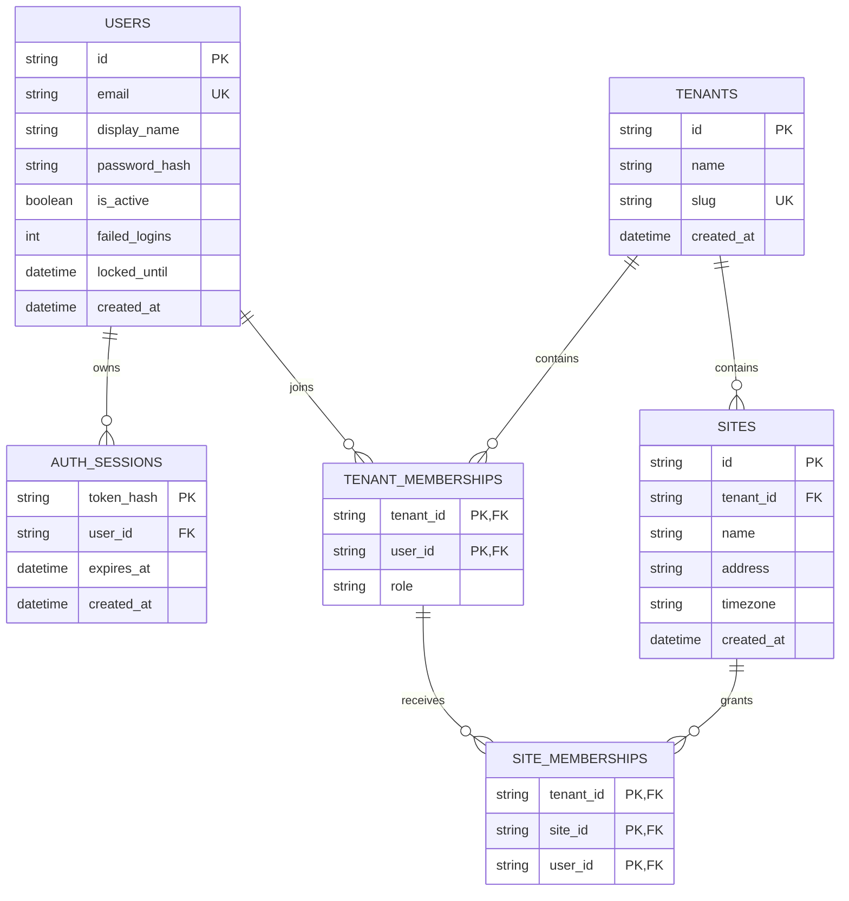

# 云端领域模型与扩展边界

登记日期：2026-11-06；事实代码基线：`7082b729785957252ff5797a057f3151c6dd25c2`。本文件发布于 `formalize-cloud-foundation-baseline` apply，承接已确认草案；最终验证/评审状态见[变更记录](../verification/cloud-foundation-baseline.md)，不代表全平台领域模型已冻结。

## 当前六表ERD及归属约束

以下ERD描述当前模型，不是待执行DDL。关系依据[模型](../../services/cloud/src/swimplatform/models.py)及[初始迁移](../../services/cloud/migrations/versions/20261106_0001_cloud_identity.py)；所有UUID均以36字符字符串持久化。

| 表 | 主键/唯一性 | 归属和约束事实 |
| --- | --- | --- |
| users | id；email全局唯一 | 全局账号，不自带tenant/site或平台管理员角色；机构权限经成员关系计算 |
| auth_sessions | token_hash | 属于user；user_id与expires_at有索引；删用户CASCADE；不保存原始token |
| tenants | id；slug全局唯一 | 机构隔离根；创建时同事务创建owner成员关系，slug冲突回滚 |
| tenant_memberships | (tenant_id,user_id) | 分别外键至tenant/user，均CASCADE；role为String(20)，当前没有数据库CHECK约束 |
| sites | id；(tenant_id,id)；(tenant_id,name) | 必须属于tenant；同机构场馆名称唯一；tenant_id有索引；删tenant CASCADE |
| site_memberships | (tenant_id,site_id,user_id) | 复合外键分别关联sites(tenant_id,id)及tenant_memberships(tenant_id,user_id)，均CASCADE |

`owner/admin/coach/athlete` 是当前API使用的成员角色；新增/改角色请求只允许admin、coach、athlete，owner由创建机构流程产生。当前API保护所有owner免于降级/移除，**数据库未单独保证每机构恰好一个owner**。文档不得把API约束写成数据库CHECK、RLS或并发事务验收结论。

## 字段、空值与默认值

UUID标识使用String(36)，token摘要使用String(64)。`users.locked_until`可为空，其余当前字段均非空；主键也非空。日期列均声明`DateTime(timezone=True)`，这是模型/DDL声明，不是不同数据库时区行为已验证的结论。

| 表 | 字段类型补充 | ORM产生的默认值 |
| --- | --- | --- |
| users | email/password_hash String(255)，display_name String(80)，is_active Boolean，failed_logins Integer；locked_until/created_at DateTime | id=uuid4、is_active=true、failed_logins=0、created_at=UTC now |
| auth_sessions | user_id String(36)，expires_at/created_at DateTime | created_at=UTC now；token_hash、user_id、expires_at由登录流程提供 |
| tenants | name String(120)，slug String(64)，created_at DateTime | id=uuid4、created_at=UTC now |
| tenant_memberships | tenant_id/user_id String(36)，role String(20) | 无；创建机构或成员管理流程提供 |
| sites | id/tenant_id String(36)，name String(120)，address String(300)，timezone String(64)，created_at DateTime | id=uuid4、address空字符串、timezone=Asia/Shanghai、created_at=UTC now |
| site_memberships | tenant_id/site_id/user_id String(36) | 无；授权流程提供 |

初始迁移没有声明这些ORM默认值为数据库server_default；不能假设绕开应用直接INSERT仍自动补齐。role、timezone、email格式等由请求/应用处理，DDL没有对应格式CHECK。

## 显式索引与删除行为

| 索引名 | 表与列 | 来源 |
| --- | --- | --- |
| ix_auth_sessions_user_id | auth_sessions(user_id) | 模型index=True；迁移create_index |
| ix_auth_sessions_expires_at | auth_sessions(expires_at) | 模型index=True；迁移create_index |
| ix_sites_tenant_id | sites(tenant_id) | 模型index=True；迁移create_index |

主键/唯一约束还可能由数据库产生隐式索引；以上列出源码声明的3个显式索引，不承诺具体数据库的内部索引名。当前没有为全部查询或未来业务设计完整索引策略。

删除user会级联其会话和机构成员，删除tenant会级联其成员和场馆；删除场馆或机构成员均通过复合外键清理相关场馆授权。该目录依据ondelete=CASCADE，实际SQLite启用外键见[数据库配置](../../services/cloud/src/swimplatform/database.py)，有限运行证据见[追溯表](../verification/cloud-foundation-baseline.md)。当前没有删除账号/机构/场馆的公开API，不能把DDL级联写成已有业务删除工作流。

## 当前权威关系与版本边界

| 关系 | 当前状态与权威来源 | 不能据此推定的能力 |
| --- | --- | --- |
| 全局账号与会话 | 已实现；云端users/auth_sessions保存账号状态和会话摘要，逐次认证读取 | 不存在全局平台管理员，也不等于邮件身份已经验证 |
| 机构成员及角色 | 已实现；tenant_memberships是机构授权依据，创建机构同时创建owner | 请求中的角色或前端菜单不是权威；没有所有权转移/唯一owner并发约束 |
| 场馆与机构归属 | 已实现；sites.tenant_id及复合外键约束资源归属，不能经场馆PATCH改机构 | 不支持跨机构搬迁场馆或历史资源迁移 |
| 普通成员场馆授权 | 已实现；site_memberships与机构成员关系共同决定访问，管理角色另有机构级权限 | 撤销管理员的显式场馆关系不取消其机构管理权；见[RBAC](../contracts/cloud-rbac.md) |
| 标识与schema版本 | 已实现UUID字符串标识和Alembic revision `20261106_0001`；API `/api/v1`、应用0.1.0 | 没有业务revision/ETag、离线快照版本或跨端冲突协议 |

当前云端保存账号、成员和场馆配置，尚不存在Edge副本、离线授权缓存或双向同步。下表链接的采集/媒体文档方向已通过2026-11-09第二轮Proposal技术审阅，但文件仍为v0.1-draft且没有业务实现。云端是TrainingSession最终业务权威不排斥Edge离线生成临时记录并在恢复联网后同步；身份映射、授权重验及冲突协议另开Change。未来Site/Tenant删除也不得经级联抹除历史Session/Asset、来源或仍需保留的内容引用；保留期限和物理清理尚未确定。

## 未实现实体与后续提案边界

| 后续实体 | 当前状态 | 后续需要评审的边界 |
| --- | --- | --- |
| Pool / Lane | 未实现，无表/接口；待组织模型提案 | 场馆内资源归属、稳定ID、归档/重命名及被历史训练引用时的策略 |
| EdgeNode / Device | 未实现，无设备身份/接入；设计方向见[采集/媒体领域草案](cloud-capture-media-domain.md)与[ADR 0003](../decisions/0003-capture-media-domain-contracts.md)，v0.1-draft | tenant/site绑定、设备凭据撤销、配置版本和设备来源；搬迁重新登记并保留历史来源，离线协议另行设计 |
| Athlete / Coach业务档案与关系 | 未实现；当前只有账号成员role，待业务授权提案 | 全局账号与机构档案分离、教练学员关系及跨场馆显式授权 |
| TrainingSession / VideoAsset | 未实现，无采集/上传、无表无接口；设计方向见[采集/媒体领域草案](cloud-capture-media-domain.md)、[API契约草案](../contracts/cloud-capture-media.md)与[ADR 0003](../decisions/0003-capture-media-domain-contracts.md)，v0.1-draft | tenant/site固定归属、云端Session最终状态与Edge离线临时记录、资源级读取授权、采集时间来源及Site/Tenant历史保留；实施仍需独立Change |
| AnalysisTask / AnalysisResult / Report | 未实现，无新版分析任务；待流水线提案 | 锁定输入版本，记录模型/规则/schema版本，任务身份、产物权限和重算策略 |
| Outbox / Inbox与同步事件 | 未实现；待云边同步提案 | 事件稳定ID、顺序/重放、幂等、云边各字段权威源与冲突处理 |

本次不为未来实体生成空表、DDL或迁移，不导入旧数据库、账号、视频和标注。旧模块只能按[取舍清单](../reference/legacy-assets.md)核对来源、许可证、依赖、输入输出与回归证据后选择性迁入，不能跨目录import旧应用。后续PostgreSQL验证的准入范围记录在[基线说明](../baseline/cloud-foundation.md)，不由此直接开放现有初始化命令。
