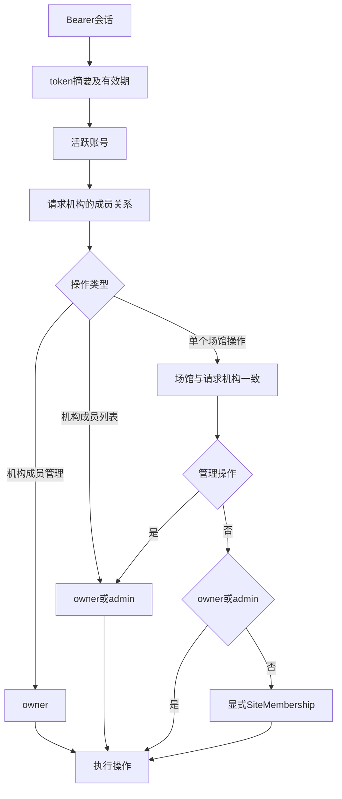

# 云端基础RBAC契约

登记日期：2026-11-06；事实代码基线：`7082b729785957252ff5797a057f3151c6dd25c2`。本文件记录现有行为，承接已确认草案，尚不等于完整安全/生产验收；当前文档验证状态见[追溯记录](../verification/cloud-foundation-baseline.md)。

## 身份、机构与场馆检查链

认证链为 `bearer → token摘要/有效期 → 活跃user`。机构资源再经过 `TenantMembership(tenant,user)`；管理操作检查role；场馆操作同时检查 `Site(tenant,site)`，普通角色再检查显式SiteMembership。依据[api.py的identity/membership/manager/site_access](../../services/cloud/src/swimplatform/api.py)，不接受客户端自报角色作为权限依据。

| 资源/操作 | 未登录 | 非本机构成员 | owner | admin | coach / athlete |
| --- | --- | --- | --- | --- | --- |
| 注册/登录 | 可提交合法请求 | 同左 | 同左 | 同左 | 同左 |
| 当前账号/退出 | 401 | 自身会话 | 自身 | 自身 | 自身 |
| 创建新机构 | 401 | 已登录者可创建自己的新机构 | 允许 | 允许 | 允许 |
| 列所属机构 | 401 | 不返回无关系机构 | 所属机构 | 所属机构 | 所属机构 |
| 机构详情 | 401 | 404 | 允许 | 允许 | 允许 |
| 机构成员列表 | 401 | 404 | 允许 | 允许 | 403 |
| 新增/移除普通成员、改普通角色 | 401 | 404 | 允许 | 403 | 403 |
| 降级/移除owner | 401 | 404 | 409 | 403 | 403 |
| 创建/修改场馆 | 401 | 404 | 允许 | 允许 | 403 |
| 场馆列表 | 401 | 404 | 本机构全部 | 本机构全部 | 仅显式授权 |
| 场馆详情 | 401 | 404 | 本机构 | 本机构 | 未授权404 |
| 授予/撤销场馆访问 | 401 | 404 | 允许 | 允许 | 403 |

“非本机构成员”是相对请求中的机构资源而言；其全局账号不因此被禁用，可能仍能访问其他合法所属机构。管理员的机构级访问不依赖显式场馆授权；给管理员撤销SiteMembership不会取消其机构级权限。文档应写清这一例外，不能承诺“撤销任意场馆授权立即禁止全部角色”。

这张图用于说明请求检查，不覆盖所有输入校验及目标成员检查顺序。场馆列表在机构membership检查后按tenant过滤；普通角色额外关联自身SiteMembership，管理角色列出本机构全部场馆，不需要单个site_id。实际行为以[路由源码](../../services/cloud/src/swimplatform/api.py)为准；矩阵假设请求结构合法、目标资源存在且归属有效，不能保证所有失败条件同时存在时的错误优先级。

## 错误与目标资源规则

| 条件 | 当前响应 | 补充 |
| --- | --- | --- |
| 无Bearer、会话不存在/过期、账号停用 | 401 unauthorized | 登录失败/锁定使用401 invalid_credentials，不泄露账号是否存在 |
| 当前用户不是请求机构成员 | 404 tenant_not_found | 机构列表仅返回自身成员关系，不暴露其他机构 |
| 机构成员角色不满足管理权限 | 403 forbidden | 机构成员增删/改角色要求owner；列表和场馆管理允许owner/admin |
| site_id不存在、属于其他机构或普通角色无场馆授权 | 404 site_not_found | site_access同时用site_id与tenant_id查询，不能混用另一个机构场馆ID |
| owner被改角色或移除 | 409 owner_transfer_required | 首版不支持所有权转移；数据库没有“恰好一个owner”的单独约束 |
| 新增机构成员的目标账号不存在/停用 | 404 user_not_found | 不能直接创建未注册账号或通过请求授予owner |
| 给非本机构成员授予场馆 | 404 tenant_not_found | 复用membership检查；复合外键还约束授权与机构成员一致 |
| 重复成员/场馆授权或同机构同名场馆 | 409 member_conflict / grant_conflict / site_conflict | 与身份不足的403区分 |

新增/改机构成员请求的role仅允许admin、coach、athlete；创建机构为自身创建owner。公开注册不接受role、tenant_id、is_superuser或is_active。请求校验来自Pydantic；role在数据库是String(20)，没有CHECK或RLS。

撤销场馆授权先检查操作者的机构/场馆管理权限，再删除匹配授权；该授权不存在仍返回204，不要求目标用户仍是机构成员。移除机构成员通过外键级联清理其场馆授权，之后请求无法通过机构membership。owner/admin的机构级访问仍遵守上文例外。

## 后续权限范围

平台管理员、机构所有权转移、业务档案及教练学员关系、离线设备授权、审计日志与RLS尚未实现。客户端tenant_id、前端菜单及用户自报角色都不构成授权依据；本次不扩展角色或修改现有校验链。

## 已有负向用例与覆盖缺口

以下链接固定在事实提交，已经核对函数及断言；运行结论引用[历史记录](../verification/cloud-foundation-baseline.md)，本次未新增/修改业务测试，也未在本机重跑。测试存在、历史通过和完整覆盖是三种不同结论。

| 已有用例 | 实际覆盖场景 | 限制 |
| --- | --- | --- |
| [`test_public_registration_rejects_privileged_fields`](https://github.com/TuIanL/zhiyong-swim-platform/blob/7082b729785957252ff5797a057f3151c6dd25c2/services/cloud/tests/test_cloud_foundation.py#L29) | 4种注册额外字段返回422 | 公开注册没有特权输入；不代表全部身份攻击已覆盖 |
| [`test_authentication_required`](https://github.com/TuIanL/zhiyong-swim-platform/blob/7082b729785957252ff5797a057f3151c6dd25c2/services/cloud/tests/test_cloud_foundation.py#L76) | me与机构列表无身份返回401 | 只有这两项路径参数化，不是每个操作无身份场景均有用例 |
| [`test_tenant_creation_and_cross_tenant_isolation`](https://github.com/TuIanL/zhiyong-swim-platform/blob/7082b729785957252ff5797a057f3151c6dd25c2/services/cloud/tests/test_cloud_foundation.py#L80) | 机构/成员/场馆查询与创建的固定跨机构请求返回404 | 不含所有HTTP操作或并发/连接池上下文 |
| [`test_member_roles_and_site_scopes`](https://github.com/TuIanL/zhiyong-swim-platform/blob/7082b729785957252ff5797a057f3151c6dd25c2/services/cloud/tests/test_cloud_foundation.py#L98) | coach未授权看不到场馆、不能建馆/列成员；admin不能改成员角色；owner提升coach后可列全部场馆 | 以coach为主要普通角色；未逐角色逐操作穷举 |
| [`test_owner_cannot_be_demoted_or_removed`](https://github.com/TuIanL/zhiyong-swim-platform/blob/7082b729785957252ff5797a057f3151c6dd25c2/services/cloud/tests/test_cloud_foundation.py#L119) | owner降级/移除返回409 | 不含所有权转移或数据库唯一owner约束 |
| [`test_site_grant_revoke_and_member_removal`](https://github.com/TuIanL/zhiyong-swim-platform/blob/7082b729785957252ff5797a057f3151c6dd25c2/services/cloud/tests/test_cloud_foundation.py#L127) | 非机构成员不能直接获场馆授权；coach授权/撤销/移除机构成员后拒绝；级联无残留 | 没有验证所有admin显式授权撤销组合 |
| [`test_cross_tenant_site_id_and_foreign_keys`](https://github.com/TuIanL/zhiyong-swim-platform/blob/7082b729785957252ff5797a057f3151c6dd25c2/services/cloud/tests/test_cloud_foundation.py#L148) | 同一账号属于两机构时混用另一机构site_id被拒；复合FK拒绝错误归属 | 有限SQLite约束验证，不是RLS或PostgreSQL验证 |

coach与athlete使用相同的非管理角色分支，但已有场景主要创建coach；因此athlete逐接口、授权新增/撤销、机构成员移除后的完整组合仍未独立验证。矩阵每一格没有对应一项运行结果，不计算虚假的完整覆盖率。

后续权限变更应补充逐角色×操作×同/跨机构×已/未授权场馆的负向用例，特别是管理员显式场馆授权撤销例外、成员角色降级和会话/权限变化后的访问。这里记录的是测试缺口，不把它们勾成已验证，也不在此文档change新增测试或实现新权限政策。

## PostgreSQL 运行证据与连接池边界（2026-11-07 追加）

本节记录 change `validate-cloud-foundation-postgresql` 的实施结果，不修改上文的历史结论。证据与提交绑定见[PostgreSQL 验证报告](../verification/cloud-foundation-postgresql.md)。

上文“已有负向用例与覆盖缺口”中列为缺口的部分，本节给出两类补充：**athlete 逐接口覆盖**与**管理角色显式授权撤销例外**。矩阵用例无 `postgresql` 标记，SQLite 与 PostgreSQL 两个后端都实际运行。

### 17 个业务 operation 的适用身份

| # | operation | 匿名 | 非成员 | athlete | coach | admin | owner |
| --- | --- | --- | --- | --- | --- | --- | --- |
| 1 | `POST /auth/register` | 201/409/422 | — | — | — | — | — |
| 2 | `POST /auth/login` | 200/401 | — | — | — | — | — |
| 3 | `GET /me` | 401 | 200 | 200 | 200 | 200 | 200 |
| 4 | `POST /auth/logout` | 401 | 204 | 204 | 204 | 204 | 204 |
| 5 | `POST /tenants` | 401 | 201 | 201 | 201 | 201 | 201 |
| 6 | `GET /tenants` | 401 | 200（仅所属） | 200 | 200 | 200 | 200 |
| 7 | `GET /tenants/{id}` | 401 | 404 | 200 | 200 | 200 | 200 |
| 8 | `GET /tenants/{id}/members` | 401 | 404 | 403 | 403 | 200 | 200 |
| 9 | `POST /tenants/{id}/members` | 401 | 404 | 403 | 403 | 403 | 201/409 |
| 10 | `PATCH /tenants/{id}/members/{uid}` | 401 | 404 | 403 | 403 | 403 | 200（owner 自身 409） |
| 11 | `DELETE /tenants/{id}/members/{uid}` | 401 | 404 | 403 | 403 | 403 | 204（owner 自身 409） |
| 12 | `POST /tenants/{id}/sites` | 401 | 404 | 403 | 403 | 201 | 201 |
| 13 | `GET /tenants/{id}/sites` | 401 | 404 | 200（仅授权） | 200（仅授权） | 200（全机构） | 200（全机构） |
| 14 | `GET /tenants/{id}/sites/{sid}` | 401 | 404 | 404/200 | 404/200 | 200 | 200 |
| 15 | `PATCH /tenants/{id}/sites/{sid}` | 401 | 404 | 403 | 403 | 200 | 200 |
| 16 | `POST /tenants/{id}/sites/{sid}/members` | 401 | 404 | 403 | 403 | 201/409 | 201/409 |
| 17 | `DELETE /tenants/{id}/sites/{sid}/members/{uid}` | 401 | 404 | 403 | 403 | 204 | 204 |

`/health` 与 `/ready` 不在 17 项业务 operation 内，单独验证：无身份可访问，`/ready` 在未迁移库返回 503、迁移后返回 200。

### 连接池配置边界

| 用途 | 配置 | 断言 |
| --- | --- | --- |
| 顺序连接复用 | `pool_size=1`、`max_overflow=0` | 交替 A/B/匿名与 409 后成功请求，`pg_backend_pid()` 全程唯一 |
| 角色矩阵与时间边界 | 应用默认池 | 只做顺序请求，不声称并发证据 |
| 并发唯一写入 / 五次失败登录 / 持锁等待 | `pool_size=8`、`max_overflow=0`、显式 `pool_timeout` | 反向断言至少两个不同 `pg_backend_pid()`；池饥饿以 `PoolTimeout` 失败 |

两者不可互换：单连接池跑并发会把池饥饿伪装成业务失败，大池跑复用则证明不了“同一连接”。

### 本节仍未覆盖

- RLS 未实施，本节所有“隔离”结论均为应用层授权与连接上下文，不是数据库行级安全。
- 撤销权限与并发写入同时发生的竞态、跨机构并发更新、连接池饱和行为未验证。
- 平台管理员、所有权转移、通用审计日志、Edge Runtime与媒体仍未实现；Cloud Edge Registry已有独立Owner/Admin登记权限和仅限本节点heartbeat的Edge身份，详见[Registry契约](cloud-edge-registry.md)。

## 训练会话与视频资产：S-read / S-manage / A-read（M2 已实现）

本节记录 2026-11-12 Apply 的 `implement-cloud-session-asset-foundation` 实际行为，代码见 [media_access.py](../../services/cloud/src/swimplatform/media_access.py) 与 [media.py](../../services/cloud/src/swimplatform/media.py)。

三项能力由**同一个谓词构造器**产出，列表、详情、Session 资产子列表与游标续页共用；非 Owner/Admin 路径**在每个请求上**重新判定当前角色，不使用登录快照，也不因为曾经授予过 grant 而永久放行。

| 能力 | 判定（`u` 为调用者） |
| --- | --- |
| S-read | `role ∈ {owner, admin}`；或 `role = coach ∧ 机构成员 ∧ 该 Site 访问 ∧ (session.created_by_user_id = u ∨ 有效 SessionReadGrant)` |
| S-manage | `role ∈ {owner, admin}`；或 `role = coach ∧ session.created_by_user_id = u ∧ 机构成员 ∧ 该 Site 访问` |
| A-read | `role ∈ {owner, admin}`；或 `role = coach ∧ 机构成员 ∧ 该 Site 访问 ∧ (asset.created_by_user_id = u ∨ 有效 AssetReadGrant ∨ 对该 Asset 的父 Session 有 S-read)` |

`有效 grant` = `revoked_at IS NULL ∧ (expires_at IS NULL ∨ expires_at > 服务端当前时刻)`。

| 操作 | 要求 | 失败语义 |
| --- | --- | --- |
| 列/读 Session、Session 资产子列表 | S-read（子列表再逐资产按 A-read 过滤） | 不可见一律 404 |
| 创建 Session | Owner/Admin，或该 Site 的 coach | 角色不足 403；非成员/错场馆 404 |
| PATCH Session（title/status） | S-manage | 可读但不可管理 403；不可读 404 |
| 读/播放签发（播放属 M3） | A-read | 404 |
| 创建上传意图 | 用户路径 S-manage；Edge 路径为节点凭据 + 同节点、同场馆、active 设备 | 403 / 404 / 409（cancelled、设备停用） |
| 授予/撤销 grant | 本机构 Owner/Admin | coach 调用 403；受授人非本机构 404；非 coach 或无该场馆访问 422 `grantee_not_eligible` |

授权记录：`session_read_grants` / `asset_read_grants` 采用软撤销（`revoked_at` + `revoked_by_user_id`，成对约束），部分唯一索引 `WHERE revoked_at IS NULL` 保证「同一资源对同一受授人只有一条有效授权」；`PUT` 为 upsert 并保留首次 `granted_at`/`granted_by_user_id`，重复撤销不覆盖首次执行者与时间。

| 行为 | 已实现语义 |
| --- | --- |
| Session grant 覆盖范围 | 该 Session 当前与之后新增的**全部** Asset（按父 Session 在每次读取时判定），不授予管理、上传或转授权 |
| 单 Asset grant | 只覆盖目标 Asset，不开放父 Session 详情、子列表或其他资产 |
| 撤权保留其他路径 | 撤销一条路径后，创建者身份、另一项有效 grant、Owner/Admin 机构范围继续生效 |
| 角色/成员/场馆失效 | 即便 grant 未到期也立即停止放行；grant 记录不被级联删除 |
| 分页 | 先按资源谓词过滤再形成页与 `next_cursor`；无 `total_count`；续页重新校验，旧游标不能绕过撤权 |

### 本节仍未覆盖

- 学员（athlete）读取路径、教练—学员关系与监护人同意未实现；本片 athlete 既不能作为受授人，也不能经资源授权读取。
- 平台角色、RLS、通用审计事件表、播放 URL 签发与端到端媒体链未实现（播放属 M3）。
