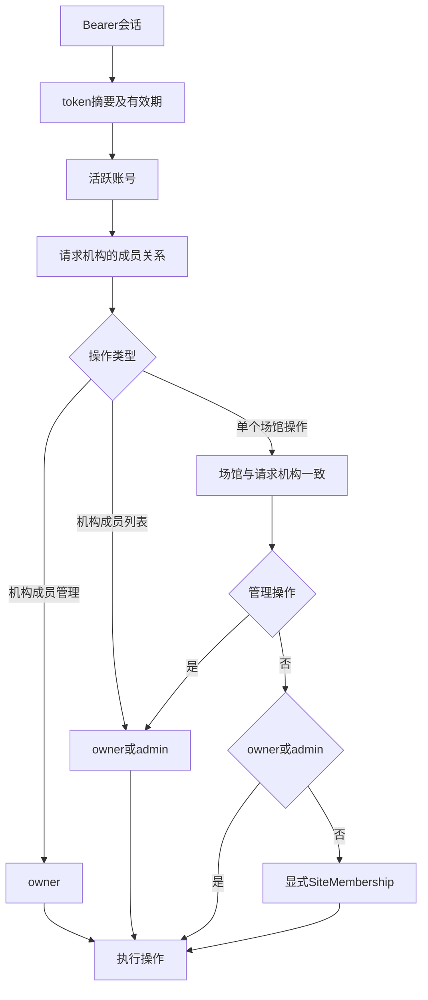

# 云端基础RBAC契约

登记日期：2026-11-06；事实代码基线：`7082b729785957252ff5797a057f3151c6dd25c2`。本文件记录现有行为，承接已确认草案，尚不等于完整安全/生产验收；当前文档验证状态见[追溯记录](../verification/cloud-foundation-baseline.md)。

## 身份、机构与场馆检查链

认证链为 `bearer → token摘要/有效期 → 活跃user`。机构资源再经过 `TenantMembership(tenant,user)`；管理操作检查role；场馆操作同时检查 `Site(tenant,site)`，普通角色再检查显式SiteMembership。依据[api.py的identity/membership/manager/site_access](../../services/cloud/src/swimplatform/api.py)，不接受客户端自报角色作为权限依据。

| 资源/操作 | 未登录 | 非本机构成员 | owner | admin | coach / athlete |
| --- | --- | --- | --- | --- | --- |
| 注册/登录 | 可提交合法请求 | 同左 | 同左 | 同左 | 同左 |
| 当前账号/退出 | 401 | 自身会话 | 自身 | 自身 | 自身 |
| 创建新机构 | 401 | 已登录者可创建自己的新机构 | 允许 | 允许 | 允许 |
| 列所属机构 | 401 | 不返回无关系机构 | 所属机构 | 所属机构 | 所属机构 |
| 机构详情 | 401 | 404 | 允许 | 允许 | 允许 |
| 机构成员列表 | 401 | 404 | 允许 | 允许 | 403 |
| 新增/移除普通成员、改普通角色 | 401 | 404 | 允许 | 403 | 403 |
| 降级/移除owner | 401 | 404 | 409 | 403 | 403 |
| 创建/修改场馆 | 401 | 404 | 允许 | 允许 | 403 |
| 场馆列表 | 401 | 404 | 本机构全部 | 本机构全部 | 仅显式授权 |
| 场馆详情 | 401 | 404 | 本机构 | 本机构 | 未授权404 |
| 授予/撤销场馆访问 | 401 | 404 | 允许 | 允许 | 403 |

“非本机构成员”是相对请求中的机构资源而言；其全局账号不因此被禁用，可能仍能访问其他合法所属机构。管理员的机构级访问不依赖显式场馆授权；给管理员撤销SiteMembership不会取消其机构级权限。文档应写清这一例外，不能承诺“撤销任意场馆授权立即禁止全部角色”。

这张图用于说明请求检查，不覆盖所有输入校验及目标成员检查顺序。场馆列表在机构membership检查后按tenant过滤；普通角色额外关联自身SiteMembership，管理角色列出本机构全部场馆，不需要单个site_id。实际行为以[路由源码](../../services/cloud/src/swimplatform/api.py)为准；矩阵假设请求结构合法、目标资源存在且归属有效，不能保证所有失败条件同时存在时的错误优先级。

## 错误与目标资源规则

| 条件 | 当前响应 | 补充 |
| --- | --- | --- |
| 无Bearer、会话不存在/过期、账号停用 | 401 unauthorized | 登录失败/锁定使用401 invalid_credentials，不泄露账号是否存在 |
| 当前用户不是请求机构成员 | 404 tenant_not_found | 机构列表仅返回自身成员关系，不暴露其他机构 |
| 机构成员角色不满足管理权限 | 403 forbidden | 机构成员增删/改角色要求owner；列表和场馆管理允许owner/admin |
| site_id不存在、属于其他机构或普通角色无场馆授权 | 404 site_not_found | site_access同时用site_id与tenant_id查询，不能混用另一个机构场馆ID |
| owner被改角色或移除 | 409 owner_transfer_required | 首版不支持所有权转移；数据库没有“恰好一个owner”的单独约束 |
| 新增机构成员的目标账号不存在/停用 | 404 user_not_found | 不能直接创建未注册账号或通过请求授予owner |
| 给非本机构成员授予场馆 | 404 tenant_not_found | 复用membership检查；复合外键还约束授权与机构成员一致 |
| 重复成员/场馆授权或同机构同名场馆 | 409 member_conflict / grant_conflict / site_conflict | 与身份不足的403区分 |

新增/改机构成员请求的role仅允许admin、coach、athlete；创建机构为自身创建owner。公开注册不接受role、tenant_id、is_superuser或is_active。请求校验来自Pydantic；role在数据库是String(20)，没有CHECK或RLS。

撤销场馆授权先检查操作者的机构/场馆管理权限，再删除匹配授权；该授权不存在仍返回204，不要求目标用户仍是机构成员。移除机构成员通过外键级联清理其场馆授权，之后请求无法通过机构membership。owner/admin的机构级访问仍遵守上文例外。

## 后续权限范围

平台管理员、机构所有权转移、业务档案及教练学员关系、离线设备授权、审计日志与RLS尚未实现。客户端tenant_id、前端菜单及用户自报角色都不构成授权依据；本次不扩展角色或修改现有校验链。

## 已有负向用例与覆盖缺口

以下链接固定在事实提交，已经核对函数及断言；运行结论引用[历史记录](../verification/cloud-foundation-baseline.md)，本次未新增/修改业务测试，也未在本机重跑。测试存在、历史通过和完整覆盖是三种不同结论。

| 已有用例 | 实际覆盖场景 | 限制 |
| --- | --- | --- |
| [`test_public_registration_rejects_privileged_fields`](https://github.com/TuIanL/zhiyong-swim-platform/blob/7082b729785957252ff5797a057f3151c6dd25c2/services/cloud/tests/test_cloud_foundation.py#L29) | 4种注册额外字段返回422 | 公开注册没有特权输入；不代表全部身份攻击已覆盖 |
| [`test_authentication_required`](https://github.com/TuIanL/zhiyong-swim-platform/blob/7082b729785957252ff5797a057f3151c6dd25c2/services/cloud/tests/test_cloud_foundation.py#L76) | me与机构列表无身份返回401 | 只有这两项路径参数化，不是每个操作无身份场景均有用例 |
| [`test_tenant_creation_and_cross_tenant_isolation`](https://github.com/TuIanL/zhiyong-swim-platform/blob/7082b729785957252ff5797a057f3151c6dd25c2/services/cloud/tests/test_cloud_foundation.py#L80) | 机构/成员/场馆查询与创建的固定跨机构请求返回404 | 不含所有HTTP操作或并发/连接池上下文 |
| [`test_member_roles_and_site_scopes`](https://github.com/TuIanL/zhiyong-swim-platform/blob/7082b729785957252ff5797a057f3151c6dd25c2/services/cloud/tests/test_cloud_foundation.py#L98) | coach未授权看不到场馆、不能建馆/列成员；admin不能改成员角色；owner提升coach后可列全部场馆 | 以coach为主要普通角色；未逐角色逐操作穷举 |
| [`test_owner_cannot_be_demoted_or_removed`](https://github.com/TuIanL/zhiyong-swim-platform/blob/7082b729785957252ff5797a057f3151c6dd25c2/services/cloud/tests/test_cloud_foundation.py#L119) | owner降级/移除返回409 | 不含所有权转移或数据库唯一owner约束 |
| [`test_site_grant_revoke_and_member_removal`](https://github.com/TuIanL/zhiyong-swim-platform/blob/7082b729785957252ff5797a057f3151c6dd25c2/services/cloud/tests/test_cloud_foundation.py#L127) | 非机构成员不能直接获场馆授权；coach授权/撤销/移除机构成员后拒绝；级联无残留 | 没有验证所有admin显式授权撤销组合 |
| [`test_cross_tenant_site_id_and_foreign_keys`](https://github.com/TuIanL/zhiyong-swim-platform/blob/7082b729785957252ff5797a057f3151c6dd25c2/services/cloud/tests/test_cloud_foundation.py#L148) | 同一账号属于两机构时混用另一机构site_id被拒；复合FK拒绝错误归属 | 有限SQLite约束验证，不是RLS或PostgreSQL验证 |

coach与athlete使用相同的非管理角色分支，但已有场景主要创建coach；因此athlete逐接口、授权新增/撤销、机构成员移除后的完整组合仍未独立验证。矩阵每一格没有对应一项运行结果，不计算虚假的完整覆盖率。

后续权限变更应补充逐角色×操作×同/跨机构×已/未授权场馆的负向用例，特别是管理员显式场馆授权撤销例外、成员角色降级和会话/权限变化后的访问。这里记录的是测试缺口，不把它们勾成已验证，也不在此文档change新增测试或实现新权限政策。
