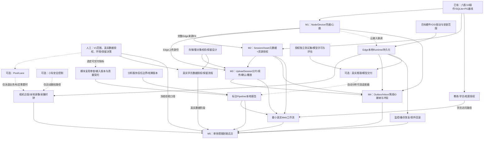

# 新版平台P0/P1研发路线重整建议

- 日期：2026-11-10（Asia/Shanghai）；状态：**建议／待负责人确认，非已批准研发顺序**。
- 事实基线：main@d7f1eedb13ac0f44abb738bc6e8b4d0d38d7766d；正式工程为swim-platform。
- 本轮只做项目审计、路线建议和单一业务Change的Propose；不Apply，不改业务代码/数据库/主规格/OpenAPI，不变更任务状态、名称、完成定义、负责人或日期，不删除/新增Notion任务。
- Notion任务库是唯一状态来源。下表“原状态”是本轮读取快照，“审计分类”不是数据库状态；建议拆分只在原任务内提出验收切片，待确认后再执行。
- 已完整查询任务库30项：**P0 13、P1 15、P2 2**，has_more=false；逐页读取全部28项P0/P1的说明与完成定义、关联文档01–10、项目主页/新版入口及旧审计。优先级P1不等于“阶段=P1”：硬件、分析、同步、Web、试点横跨多个阶段。
- [项目主页](https://www.notion.so/410f602574aa816ea4a6f2b06985d412)；[开发任务库](https://www.notion.so/6495f7cc5aec415aa0bcd4dead54bba2)；[新版工程入口](https://www.notion.so/410f602574aa81288834cc297ae5b039)。

## 1. 真实基线与证据索引

| 编号 | 本轮核对的实际证据与边界 |
| --- | --- |
| E1 | [PR1](https://github.com/TuIanL/zhiyong-swim-platform/pull/1) merged，4968750：六表/19操作事实基线补录，12/12文档任务；不是新业务功能实施。 |
| E2 | [模型](../../services/cloud/src/swimplatform/models.py)、[初始迁移](../../services/cloud/migrations/versions/20261106_0001_cloud_identity.py)、[历史取舍](../reference/legacy-assets.md)：只有users/auth_sessions/tenants/tenant_memberships/sites/site_memberships六表；新版无媒体、Edge、分析、报告与前端业务模块。 |
| E3 | [API](../../services/cloud/src/swimplatform/api.py)、[输入模型](../../services/cloud/src/swimplatform/schemas.py)、[现有OpenAPI](../contracts/openapi.json)：14 paths/19 operations；注册extra=forbid，机构角色与User分开；Owner/Admin机构管理、Coach/Athlete显式场馆范围。 |
| E4 | [基础测试](../../services/cloud/tests/test_cloud_foundation.py)、[角色矩阵/拒绝无副作用](../../services/cloud/tests/test_authorization_matrix.py)：注册注入、撤权/移除、owner保护及完整当前角色矩阵；不是未来Session/Asset权限验证。 |
| E5 | [PR2](https://github.com/TuIanL/zhiyong-swim-platform/pull/2) merged，afb0e5f，16/16；[PG验证](../verification/cloud-foundation-postgresql.md)、[schema测试](../../services/cloud/tests/test_postgresql_schema.py)、[事务测试](../../services/cloud/tests/test_postgresql_transactions.py)、[RLS边界](../decisions/0002-postgresql-validation-and-rls-boundary.md)。只证明专用schema/最小权限/约束/角色/并发/清理，不证明RLS或生产部署。 |
| E6 | [PR3](https://github.com/TuIanL/zhiyong-swim-platform/pull/3) merged，d7f1eed，11/11；[领域模型](../architecture/cloud-capture-media-domain.md)、[API草案](../contracts/cloud-capture-media.md)、[ADR0003](../decisions/0003-capture-media-domain-contracts.md)。D1–D10设计方向已评审，v0.1-draft/未实现；UploadSession、EdgeCredential只是支持概念；物理授权表、MediaBlob与离线协议未定。 |
| E7 | [三份归档](../../openspec/changes/archive/)均已完成，无活跃Change（本轮新Propose建立前）；[当前主规格](../../openspec/specs/cloud-identity/spec.md)10要求。main [CI42785944217](https://github.com/TuIanL/zhiyong-swim-platform/actions/runs/42785944217)绑定d7f1eed：SQLite112/PG150通过，PG removed、兜底absent/exit0；原始证据与本轮规划CI分列。 |
| E8 | [历史资产取舍](../reference/legacy-assets.md)、[模型选型配置](../../configs/public_pose_baseline.json)：旧NormalizedAnnotation/指标/规则/ReportData为选择性复用候选，未导入新版；RTMO-l Large/COCO17/官方Body7仅默认选型，未接入推理。 |
| E9 | Notion [01产品](https://www.notion.so/410f602574aa816f8464c81eec320d32)、[02架构](https://www.notion.so/410f602574aa81e19ab0d47c70417236)、[03组织/权限](https://www.notion.so/410f602574aa8170b565f7fc4c5eab30)、[04 Edge](https://www.notion.so/410f602574aa8142a2ecde4eb3a6872a)、[05硬件](https://www.notion.so/410f602574aa815692d5c3a1e2b16351)、[06分析](https://www.notion.so/410f602574aa819fb8fbf5c03441877d)、[07同步/API](https://www.notion.so/410f602574aa81cda7bff8c3ed483f4d)、[08安全](https://www.notion.so/410f602574aa81689191fd9087273494)、[09验收](https://www.notion.so/410f602574aa818e9c80f46f46668d2e)、[10 ADR](https://www.notion.so/410f602574aa81618d05efd317151022)多为草稿/待评审；[旧审计](https://www.notion.so/410f602574aa8146abf8e5ee02197d0d)明确对象swim@9f1473b及未提交修改，不是新版main审计。 |

### 四类事实必须分开

1. **已有实现**：六表账号/机构/场馆、19操作、隔离SQLite/PG验证。不是完整商业化身份、生产环境或RLS。
2. **已批准设计方向**：D1–D10、固定tenant/site/来源、独立Edge身份、云端Session权威兼容离线临时记录、资源级授权、原始采集时间、完整上传/终态事务和三层身份；文档已合并，业务未实现。
3. **待实施功能**：Node/Device/Credential、Session/Asset/grant、UploadSession/存储、Runtime/同步、分析/结果/报告和多端。
4. **待人工决定**：V1场景与指标、Pool/Lane、真实数据授权/保留/存储、Edge环境与硬件、离线接纳规则、模块复用与许可、后续角色和生产门槛。文档中的建议不能直接升级为产品承诺。

## 2. P0完成情况总表

覆盖用户点名的11项，以及任务库额外2项OpenSpec基线/隔离环境，共13项。每行任务名可进入原始完成定义；证据E1–E9见上表。本轮没有据此改动原状态。

| 原任务（原状态） | 本轮审计分类 | 已交付与未交付／完成定义核对 | 建议与阻塞边界 | 证据 |
| --- | --- | --- | --- | --- |
| [P0｜建立新版工作区、历史资料归档与独立 Git](https://app.notion.com/410f602574aa81c0b1b2ee886c926594)（待验收） | 待负责人验收 | 独立Git/目录已交付；19项资料/23旧链接仅有历史复核记录，本轮不重跑历史恢复。 | 确认既有归档交付即可；不阻塞新版隔离开发。 | E1/E9 |
| [P0｜核验现有仓库与部署基线](https://app.notion.com/410f602574aa81198a75f657a3f41fca)（待验收） | 需要重新定义范围 | 当前完成定义/478后端+57前端证据指旧swim@9f1473b；新版仅六表云端，不是同一审计对象。 | 原记录区分旧审计验收与新版main清单/部署边界；不把旧漏洞写成新版现存漏洞。 | E2/E3/E8/E9 |
| [P0｜确认首版业务范围与试点验收口径](https://app.notion.com/410f602574aa8180b6c5c589e2117b01)（待确认） | 待负责人决策 | 01/09仍草稿：场馆、泳姿、机位、路数、指标、复核、保留未冻结。 | 决定真实数据/试点范围；不要求先完成所有试点能力才开发节点登记。 | E9 |
| [P0｜建立新版普通注册与角色授予约束](https://app.notion.com/410f602574aa81b8b6dac098a8149b82)（待验收） | 待负责人验收 | 特权字段拒绝、角色来自成员关系、owner保护有代码和两后端证据；本任务仍待验收。 | 建议验收当前注册子范围；邮件/找回/审计/公网防滥用另列后续，不重复注册实现。 | E3/E4/E5 |
| [P0｜定义租户隔离与 RBAC 权限矩阵](https://app.notion.com/410f602574aa816e87dcd70f56c4100e)（进行中） | 部分完成 | 四角色机构/场馆矩阵和PG撤销/无副作用已验收；媒体资源grant仅文档，RLS/平台角色未实施。 | 按基础授权、资源授权、RLS/平台角色分切片；只有所触及资源的权限是模块门槛。 | E3/E4/E5/E6 |
| [P0｜评审新版数据模型与历史资产取舍边界](https://app.notion.com/410f602574aa811bbad3c6e452a065b6)（进行中） | 部分完成 | 原六表与PG约束已实现；Edge/Session/Asset等设计方向已评审；未来表、旧模块迁入未实施。 | 保留六表与旧数据不迁入的事实；分模块增量迁移，Pool/Lane另决策。 | E2/E5/E6/E8 |
| [P0｜建立系统架构与接口契约基线](https://app.notion.com/410f602574aa816582ccc14817ce4601)（进行中） | 部分完成 | 19个既有操作有正式契约；PR3的33个未来操作/ADR已交付，分析/同步/生产总体未冻结。 | 建议将当前基线和采集文档验收记录封存，未来模块各自行为Change补契约。 | E3/E6/E7 |
| [P0｜建立新版媒体上传、绑定与下载授权边界](https://app.notion.com/410f602574aa811094bec51f53fe50e3)（未开始） | 尚未实施 | 无媒体表/路由/存储；PR3只给方向。原任务仍写替换、Range、打印/PDF，混有后续范围。 | 资源模型+授权同片；二进制上传/播放另验；不可变原件的替换应新Asset，PDF归报告阶段。 | E2/E3/E6 |
| [P0｜建立新版分析结果入口的服务身份约束](https://app.notion.com/410f602574aa81c99de4d2415349917c)（未开始） | 尚未实施 | 新版无AnalysisTask/result回调；旧匿名回写风险仅是历史输入。 | 分析任务接入前决定内置持久化还是服务回调；如回调则校验身份、task/input revision、幂等。 | E2/E3/E8 |
| [P0｜打通现有标注驱动分析闭环](https://app.notion.com/410f602574aa81148467fb103034d37b)（未开始） | 需要重新定义范围 | 旧原型存在复用候选；新版无标注、Pipeline、报告或PDF实现，不是把旧闭环直接接通。 | 重写为新版选择性引入：来源/许可/依赖→输入快照/质量门禁→本地报告；与Pipeline任务合并验收切片。 | E2/E8/E9 |
| [P0｜制定并执行单场馆端到端试点验收](https://app.notion.com/410f602574aa81dcb74bd39b29968831)（待确认） | 尚未实施 | 任务在P8，完成定义要求真实场馆数据、性能、反馈、上线/暂缓结论；无新版现场证据。 | 拆为现在制定验收用例/阈值，模块完成后才执行现场验收；不是所有开发的前置。 | E9 |
| [P0｜建立新版 OpenSpec 基线与历史规格取舍清单](https://app.notion.com/410f602574aa813c91bdf17c4ba49ed2)（已完成） | 已完成 | PR1的12项文档交付、独立Verify/归档/合并已成立；不继承旧49规格。 | 保留已完成状态，后续模块独立Change。 | E1/E7 |
| [P0｜建立新版独立运行环境与隔离测试基线](https://app.notion.com/410f602574aa81e8a757def927b364df)（已完成） | 已完成 | 独立环境、隔离SQLite/PG迁移、容器归属/清理、应用最小权限验证已验收。 | 复用测试编排；新业务表和用例必须扩展，RLS/生产部署不混在本完成范围。 | E4/E5/E7 |

分类汇总：已完成2；部分完成3；待负责人验收2；待负责人决策1；尚未实施3；需要重新定义范围2。既有待验收项不因本次读取自动完成；“旧审计验收”和“新版完整部署审计”不合并判定。

旧审计的后端478 passed/90 skipped、前端57 passed和构建通过，只属于旧对象及其验证边界。本轮不把它们并入新版112/150计数，也不把旧90项跳过解释成新版测试缺陷。

## 3. P1依赖关系总表

原“依赖P0架构与相关前置模块”不能直接变成可执行顺序。下表保留原状态，改用具体接口、数据、环境和决策门槛；不重复建设Tenant/Site。

| 原任务（原状态） | 本轮判断 | 原依赖／完成定义 | 重整后的依赖与实施建议 | 门槛类型 | 证据 |
| --- | --- | --- | --- | --- | --- |
| [P1｜建设新版账号、机构与场馆云端基础](https://app.notion.com/410f602574aa81c8bfa0e4728a58b737)（进行中） | 已实现子范围，整体未完 | 现有Tenant/Site/四角色及PG验证可直接用；原完成记录还包含后续身份能力。 | 不重建；建议在原任务中区分已验收基础与邮件/审计/公网等后续。 | 既有基础 | E2/E3/E5 |
| [P1｜实现 Tenant / Site / Pool / Lane 组织模型](https://app.notion.com/410f602574aa818c85a9d73478666867)（待确认） | 部分完成；待范围决定 | 原泛称P0；正文已写不重复Tenant/Site，但完成定义未覆盖Pool/Lane。 | 仅在首版需泳道排程、空间标定/明确池泳道业务时扩展；否则继续Site级，生命周期另片。 | Pool/Lane不是首片硬依赖 | E2/E6/E9 |
| [P1｜建设 Edge Node 注册、心跳与健康管理](https://app.notion.com/410f602574aa81e9bfa5cb7ca947e7f7)（待确认） | 推荐第一片 | 原泛称P0；完成定义含注册、在线状态、版本/健康摘要、可撤销身份。 | 已有基础+本次规格评审→Node/Device登记+凭据+心跳；不等真实硬件/对象存储。 | 后续Edge云接入、设备来源技术前置 | E3/E6 |
| [P1｜建立 Edge Runtime 基础部署包](https://app.notion.com/410f602574aa81608463d9de3e26368a)（待确认） | 尚未实施 | 原泛称P0；需目标GPU机、OS/驱动/Compose和无公网本地API/存储。 | 先决目标环境/安装范围；可并行设计与独立本地包，云注册联调再接第一片。 | 环境决策/设备是硬依赖；云Registry非本地安装前置 | E8/E9 |
| [P1｜建设教练-学员授权关系与学员档案](https://app.notion.com/410f602574aa810eb1f2e547f585ffcc)（待确认） | 尚未实施 | 原泛称P0；定义档案/班组/监护人及关系审计。 | 先定档案/同意与身份语义；面向学员的数据访问前完成；不是管理员/创建者媒体片的绝对前置。 | 学员端/基于学员访问必需 | E6/E9 |
| [P1｜完成摄像头 RTSP/SRT 接入与本地录像](https://app.notion.com/410f602574aa81fb9900e59b23d832fc)（待确认） | 尚未实施 | 原泛称P0；至少一台实际摄像设备、录制/元数据/回放和掉线测试。 | 相机/协议+本地存储/时间字段→台架录制；可与云端并行，正式上传前绑定可信Device来源。 | 采集路径前置；本地测试不等全部云功能 | E6/E9 |
| [P1｜定义小车设备协议与安全控制接口](https://app.notion.com/410f602574aa81cb9fdfcbc48033d225)（待确认） | 尚未实施 | 原泛称P0；模拟器+急停/掉线停车/限速/权限台架测试。 | 先安全边界/硬件接口，再运动跟拍；不阻塞固定摄像头和人工导入。 | 自动小车路径的安全硬依赖 | E9 |
| [P1｜实现云端视频分片上传与完整性校验](https://app.notion.com/410f602574aa8129ab07d088ad80aa5b)（待确认） | 尚未实施 | 原泛称P0；upload_session/短凭据/续传/SHA/云端确认。 | Session/Asset+同片授权+存储/校验策略；Edge路径还需节点身份/来源；先共享契约后实现。 | 媒体ready/云同步技术前置 | E6/E9 |
| [P1｜建立云边 Outbox/Inbox 事件同步](https://app.notion.com/410f602574aa8181a19ae87e25b62b4d)（待确认） | 尚未实施 | 原泛称P0；事务事件/ACK/去重/重试/冲突。 | 稳定聚合ID/版本与离线接纳规则+本地持久化/节点身份；不能把HTTP重试当可靠事件同步。 | 跨断网业务同步前置；不阻塞云Registry | E6/E9 |
| [P1｜将分析任务执行器改为可选 Pipeline](https://app.notion.com/410f602574aa812e9d4cd3bc5190bc4a)（待确认） | 新版尚未实施 | 原依赖代码/契约审计；旧原型已有Pipeline候选，新版无执行器。 | 与P0标注闭环共用一次新版引入；固定输入revision/阶段/重试，先annotation，再可选model。 | 分析闭环前置；不等待真实AI模型 | E8/E9 |
| [P1｜建立模型推理服务与版本交付流程](https://app.notion.com/410f602574aa81f3b024efef51611838)（待确认） | 尚未实施 | 原泛称P0；模型包/版本/校验/许可证/评估和Edge安装回滚。 | 独立评估+来源/许可+固定推理环境→模型适配器；RTMO选型配置不等运行接入。 | 自动分析可选路径；不阻塞人工标注报告 | E8/E9 |
| [P1｜建立 AI 模型独立测试集与指标评估](https://app.notion.com/410f602574aa81b29ad6d54917c7b2ed)（待确认） | 尚未实施 | 原泛称P0；分泳姿/机位/遮挡评估，测试集不混训练集。 | 经授权样本+冻结协议即可并行；指标阈值由负责人结合试点决定，不借旧训练结果验收。 | 模型商业交付前置；可脱离Web/云业务开展 | E8/E9 |
| [P1｜实现教练端与学员端 Web 工作流](https://app.notion.com/410f602574aa81d6b219f898991858b1)（待确认） | 尚未实施 | 原泛称P0；视频/报告入口与角色E2E；新版无Web源码。 | 先按真实API提供管理员/教练最小界面；学员端等档案关系/同意与资源授权；原型可并行但不算业务交付。 | 用户闭环依赖业务API；Flutter/PWA为P2另决策 | E2/E6/E9 |
| [P1｜完成隐私授权、视频保留和删除流程](https://app.notion.com/410f602574aa8121a9e4c5cfcb5131d2)（待确认） | 待负责人决策及实施 | 原写项目启动先行；同时包含政策、授权文本、技术删除与演练。 | 政策/数据清单可立即并行；真实可识别学员数据采集前完成相应授权；删除实现依资源/存储，不提前全库级联。 | 真实数据/上线门槛；不是合成数据Registry门槛 | E6/E9 |
| [P1｜建立 Edge 监控、日志、备份与升级回滚](https://app.notion.com/410f602574aa81c2a9a6de9c80863f0b)（待确认） | 尚未实施 | 原泛称P0；磁盘满/崩溃/断网/升级/备份恢复演练。 | 依已部署Runtime/持久化；软件回滚和备份恢复先于试点，模型回滚按模型是否纳入；心跳摘要不等本任务完成。 | 运行与试点前置；非云登记前置 | E9 |

P2原记录仅作为后续边界：[Flutter/PWA](https://www.notion.so/410f602574aa81be814ad25c9a6674f3)、[平台/机构/场馆后台](https://www.notion.so/410f602574aa81a8947cdfe9c8224434)，两项均待确认，不擅自升为P0/P1或立刻选框架。

## 4. 总体技术依赖图

实线表示所选交付的技术/验收硬依赖；虚线表示可并行准备、可选路径或需产品选择后才激活的关系。图是建议，不是已执行任务调度。

注意：TrainingSession本身不依赖单一EdgeNode；人工上传也可以没有Device来源。图中Registry→Session/Asset表示推荐一次实现完整来源模型，避免先造人工专用模型再重写；不是声称Session必须在线经过Edge。Asset首条记录必须与UploadIntent/UploadSession原子创建，M2/M3需共同承接此边界，不能另造孤立Asset创建接口或以测试fixture冒充业务闭环。摄像头独立台架可先做，图中Runtime→Capture指可交付的新版集成录像；Outbox通用投递也可在稳定事件契约和本地事务之后先做，图中Upload→Sync指媒体完成事件集成。标注引擎的纯契约/合成样本验证可先行，真实输入接入仍须相应媒体授权与数据许可。云端Registry不依赖完整Runtime、RLS、Pool/Lane、GPU模型或最终场馆验收。

### 可并行、人工与验收工作

- 可立即并行准备：范围/隐私/硬件决策；新版资源模型与授权规格细化；旧引擎复用可行性和授权样本/标准输入调查；目标Edge安装方案；相机/小车台架协议。它们是后续切片准备，不在本轮额外创建Change或宣称实施完成。
- 必须随模块交付：资源授权、输入校验、归属、持久化原子性、两后端回归；不能先交付裸媒体访问再补权限。
- 纯验收/确认：工作区历史交付、普通注册现有子范围；无需为通过它们重写已有实现。最终试点则是集成后的实际验收，先定义用例、最后执行。
- 人工门槛只阻塞受影响路径：真实个人视频之前的授权/保留、现场验收前的负载与指标、运动小车之前的安全台架；不把所有待决P0一律变成Registry开发阻塞。

### 建议在原任务内拆分的验收切片（本轮不执行）

1. 旧仓库审计 / 新版实现清单 / 新版部署现场核验分开，保留旧证据。
2. RBAC拆已验收机构/场馆、Session/Asset资源权限、教练—学员、未来平台角色/RLS；RLS仅按其独立范围决策。
3. 数据模型/架构拆六表既有基线、采集媒体设计已交、逐模块行为实施、分析/同步/生产未决。
4. 媒体拆元数据/资源grant、二进制完整性/播放、报告派生访问；旧“替换”改为不可变原件下的新Asset，不复用公开路径。
5. 标注闭环与Pipeline共享新版引入切片，独立输入/质量门禁、任务持久化与报告、真正GPU模型可选；不两次“改造”同一执行器。
6. 试点拆口径/用例设计和现场执行/上线结论；隐私任务拆人工政策与技术执行/删除演练。建议写入原任务，是否另立子任务由负责人确认，本轮不创建重复任务。

## 5. 下一阶段里程碑建议

各里程碑均经过各自Propose→负责人确认→明确Apply→独立Verify→Archive→本PR合并授权；没有日期、负责人或固定SLA承诺。

| 里程碑 | 推荐交付 | 进入/退出条件与可并行项 |
| --- | --- | --- |
| M0 范围与旧账收口 | 决定V1目标；确认旧审计/新版审计的对象；处理现有待验收子范围 | 不等待所有业务实现；明确真实样本、硬件和数据策略的批准门槛。建议先以有限机位、标注驱动、人工复核验证闭环，是否纳入小车/自动AI由负责人决定。 |
| M1 云端设备基础 | 本次唯一提案：Node/Device、专用凭据、心跳/版本健康观测 | 复用六表与隔离PG；mock客户端可完成验收；不实施Runtime或视频。 |
| M2 云端业务资源及访问 | Session/Asset元数据、同范围来源/派生、资源grant及所有读取路径 | 不交付无授权的媒体壳；Session/Asset状态不能在没有整对象校验时伪造ready。可并行进行Runtime/相机、引擎复用准备。 |
| M3 媒体与本地组件 | 分片/续传/服务器校验/终态事务/播放；Edge最小安装、录像；标注Pipeline/报告模块独立验收 | 存储/保留与授权样本已决；真实录像不等于已云同步，局部引擎测试不等于端到端报告。 |
| M4 云边可靠业务闭环 | 离线接纳/ID映射/事件ACK与冲突；结果服务身份；真实API上的最小Web/学员权限 | Runtime+稳定资源+可靠媒体+分析/报告打通；离线用户权限快照策略单独批准；Coach资源grant不自动等于学员关系。 |
| M5 单场馆现场验收 | 摄像/Edge/报告/授权/断网恢复/同步/备份升级全链路及上线/暂缓结论 | 用已冻结场景测真实负载与故障；模型/小车仅在选定首版范围时加入相应验收。 |

模型独立测试集/许可和真实推理服务可独立推进，但不会作为标注驱动首个报告的前置。完整Web/PWA/Flutter和平台后台按实际用户旅程分阶段，不能为了“多端”先复制演示页面。

## 6. 第一项业务Change比较与推荐

| 选项 | 当前收益与风险 | 推荐位置 |
| --- | --- | --- |
| EdgeNode/Device基础 | 已有Tenant/Site与D1/D2/D3；不用对象存储/GPU/旧引擎，能用独立客户端测来源与可撤销身份，为真实Edge接入提供锚点 | **首选第一片**；不将其包装成完整Edge Runtime |
| TrainingSession/VideoAsset | 更接近用户视频价值；但完整来源FK需要Node/Device，资源grant与状态/上传边界须同片明确 | 第二片；Session可独立设计，不因在线节点不可用禁止离线临时采集 |
| 媒体资源权限 | 是每个媒体接口必备横切能力；没有稳定资源与来源时单做“权限模块”难验收 | 随M2/M3交付，不能拖到媒体开放后 |
| 视频上传 | 需要资源/授权、存储、校验worker、续传和终态竞态，范围比Registry大 | M3，不能用一次PUT或分片回执代替 |
| Edge Runtime | 重要但依赖目标设备/OS/GPU/本地身份和离线持久化决策；可并行做准备和单机切片 | 独立路径，与云Registry在联调时汇合 |
| 标注驱动分析闭环 | 最直接验证产品价值，但旧引擎尚未评估引入、新版无任务/输入/报告模块 | 早期并行做复用与契约准备，M3独立交付；不等待模型服务，不冒充已有新版闭环 |

唯一新Change为 [implement-cloud-edge-device-foundation](../../openspec/changes/implement-cloud-edge-device-foundation/proposal.md)。**推荐并不等于负责人已确认主线或授权Apply。**

| 项目 | 推荐范围/验收 |
| --- | --- |
| 输入 | main六表/19操作及PG验证、ADR0003 D1/D2/D3/D8/D9、节点原任务完成定义；Owner/Admin真实成员上下文、合成节点元数据与可控时钟 |
| 输出 | 拟新增EdgeNode/Device/EdgeCredential及最小持久化幂等记录；12个节点/设备/凭据/心跳操作、迁移与OpenAPI增量、共享与PG专属回归证据；本轮只交付这些工作的规划 |
| 硬依赖 | 负责人确认第一片范围及候选凭据/在线/健康/幂等参数后，另给Apply授权；既有账号/机构/场馆和专用PG可用；不依赖生产库、真摄像头或完整V1冻结 |
| 复用的原任务 | 直接推进Edge Node注册任务，以及数据模型、架构/API和RBAC的局部子范围；Device登记放在本片，物理小车协议不在内，不创建平行任务台账 |
| 排除 | Pool/Lane、Session/Asset/grant/UploadSession、真实文件上传/存储、Edge Runtime/控制、分析/模型/Web、Outbox/Inbox、RLS、生产部署和真实学员数据 |
| 安全/权限验收 | Owner/Admin仅本机构管理；其他角色即使有Site权限也不能管理登记；跨机构/错场馆拒绝；Edge/user凭据隔离；撤销/到期/停用/重启后无越权或密钥泄露 |
| 关系/事务验收 | Node归Site、Device归Node复合FK；归属不可变，迁移新ID、历史保留；停用与凭据签发/撤销/心跳竞态线性化；同键同参并发唯一结果，同键异参409，凭据重试不重放secret |
| 心跳验收 | server last_seen_at决定在线状态；客户端时间/health/版本不能改身份或desired配置；版本与有界健康摘要可查询；重启不遗失凭据撤销和最近观测 |
| 两后端/迁移验收 | 旧六表数据/行为保持，新表反射、约束、增量迁移/回滚、应用最小权限成立；完整SQLite/PG实际执行，PG并发证明独立物理连接、cleanup可靠；不靠固定旧112/150计数宣称新场景已跑 |

当前cloud-identity把应用测试授权和schema检查固定为六表。新增业务表必须显式扩展已批准表集合，而不是给应用schema所有权/任意未来表权限。因此本提案含cloud-edge-registry新增规格及cloud-identity两项MODIFIED增量；只写Change内delta，**不修改主规格**，原Purpose及其余8项要求保持不动。

## 7. 需要负责人决定的事项与影响范围

| 决策 | 推荐/待确认 | 阻塞哪些工作 |
| --- | --- | --- |
| Q1 下一主线 | 推荐先云端Registry，再完整Session/Asset+授权；允许Runtime/分析复用准备并行 | 本Change Apply之前需确认；本轮Propose可供审阅 |
| Q2 首版场景 | 明确场馆/泳姿/机位/路数/指标/复核及验收阈值；不把硬件估算当SLA | 真实数据/算法指标/场馆试点；不阻塞合成数据Registry |
| Q3 Pool/Lane | 仅有明确泳道排程/标定需求才纳入首版，否则沿用Site、以后扩展 | 组织模型与相关采集/训练字段；不是Node基础硬依赖 |
| Q4 首版访问人群 | 管理员/创建者Coach+显式grant可先形成受控模块；学员端需档案关系/真实授权 | 面向学员的访问与Web；不能拿Site授权代替媒体权限 |
| Q5 视频/数据政策 | 存储区域/产品、是否同步完整视频、保留/配额/删除和真实样本授权 | 二进制媒体实施与真实数据使用；不是节点登记 |
| Q6 Edge环境与安全 | 目标OS/GPU/驱动/容量、固定摄像还是小车、运动安全台架、离线身份宽限与接纳冲突策略 | Runtime/现场/Outbox；不在Registry偷偷选完整部署栈 |
| Q7 复用与模型 | 批准可复用模块/依赖/许可证和授权样本；默认RTMO配置仍须真实推理/评估验证 | 新版引擎引入、模型交付；手工标注路径不等待模型 |
| Q8 Registry实施参数 | 本提案推荐凭据默认7天/最长30天，在线90秒窗口；健康仅版本+状态；幂等记录先持久保留不自动淘汰，生产容量/回收需后续评审 | 当前第一片的具体行为；在独立Apply前评审，绝非沿用PR3的批准 |
| Q9 原任务范围修订 | 确认第4节切片与旧措辞调整后，再修改Notion完成定义/依赖或状态 | 台账正式调整；本轮仅建议，不批量写状态、不删除/重复建任务 |

## 8. 本轮交付与停止边界

本轮形成路线建议与一个业务Propose；Notion仅追加评审回链，任务属性保持原样。Draft PR/提交及本轮检查、CI结果由Notion工程入口和该PR绑定，不能用此前main CI替代新提案提交CI。规划产物完成与实施任务0/14分别报告。

结构strict只验证格式；还须核对上述28项覆盖、依赖图没有把可选路径设为全局阻塞、与D1–D10和现有六表的兼容、规格两项增量完整及本地链接。仅为规划变化，不在本机运行迁移/数据库或重复业务测试；自动CI仍只回归既有云端基础。完成后等待负责人确认路线及提案，不自行Apply、Verify、Archive、同步主规格或Merge。
