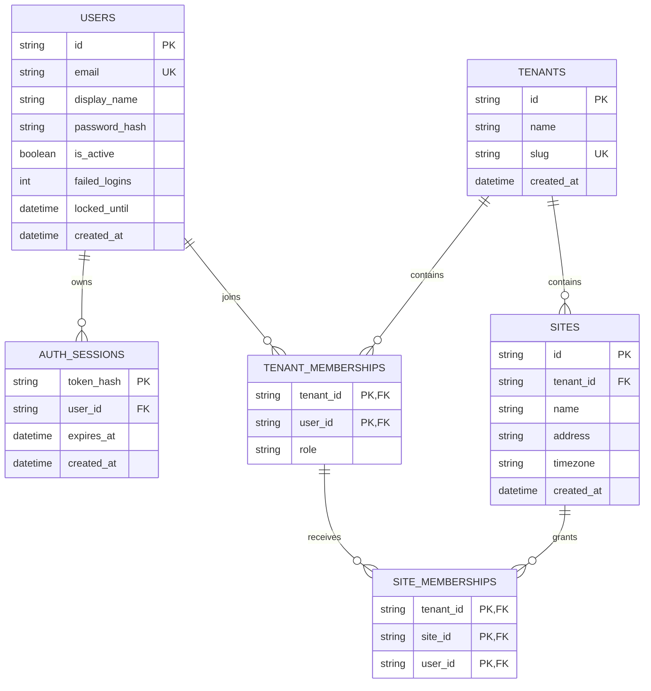

# Design

## Context

动机和范围见 `proposal.md`。本设计是对提交 `7082b729785957252ff5797a057f3151c6dd25c2` 的事后登记草案，供评审与后续文档 apply 使用。记录时间为 2026-11-06，不倒写此前审批或验收状态。

已读取的证据包括 `services/cloud/src/swimplatform/`、初始迁移 `20261106_0001`、测试、`docs/contracts/openapi.json`、`docs/verification.md`、当前 `cloud-identity` 主规格和关联 Notion 任务。此提交含独立账号、机构及场馆的本地开发切片；主规格有5项要求，已有22项本地测试及CI通过的历史记录，但尚未形成 change 级治理闭环。

本文区分三种记录：**已有实现**是从代码核对的事实；**已有运行证据**引用原提交的测试/CI与HTTP记录；**本变更待执行**是正式文档发布、追溯复核和评审工作。本轮规划没有重跑业务测试、连接数据库或进行新的完整实现验收。

## Goals / Non-Goals

**Goals:**

- 给出可直接评审的六表ERD、归属/约束目录、权限矩阵、19项HTTP操作清单及主规格追溯关系。
- 用可复查证据支持现有能力，不把源码存在、旧测试通过或规格校验当成新业务验收。
- 规定正式文档的发布位置、任务边界、评审记录和后续 PostgreSQL 提案入口，避免多个来源维护相互矛盾的完成状态。

**Non-Goals:**

- 不修改运行行为、业务代码、schema、迁移、依赖、测试或现有主规格；本 change 已设置 `skip_specs: true`。
- 不替业务负责人批准首版商业范围、角色政策、生产隔离或部署；不启动 apply、verify-change 或 archive。
- 不实施 PostgreSQL/RLS、平台管理员、Pool/Lane、学员档案、媒体、训练、分析、Edge、同步或UI。

## Decisions

### D1：固定历史基线，按文档型变更补录

**选择：**把 `7082b72` 作为本次事实基线，主规格保持原文。纯文档变更跳过规格增量，借助本文的追溯表引用现有要求；正式文档在后续 apply 中发布。

**理由：**现有 API 行为没有在本次改变。创建“历史登记能力”或重新添加已有5项要求会制造不存在的系统变更；把本次当作原实现的事前提案又会破坏时间线。

**考虑的替代：**回写主规格、重复建立 cloud-identity 近似能力、将已有测试直接勾选为本 change 全部完成，均不采用。旧验证记录继续保留原貌。

### D2：把当前六表模型与后续领域设计明确分开

以下ERD描述当前模型，不是待执行DDL。关系依据 `models.py:20` 起及初始迁移；所有UUID均以36字符字符串持久化。

| 表 | 主键/唯一性 | 归属和约束事实 |
| --- | --- | --- |
| users | id；email全局唯一 | 全局账号，不自带tenant/site或平台管理员角色；机构权限经成员关系计算 |
| auth_sessions | token_hash | 属于user；user_id与expires_at有索引；删用户CASCADE；不保存原始token |
| tenants | id；slug全局唯一 | 机构隔离根；创建时同事务创建owner成员关系，slug冲突回滚 |
| tenant_memberships | (tenant_id,user_id) | 分别外键至tenant/user，均CASCADE；role为String(20)，当前没有数据库CHECK约束 |
| sites | id；(tenant_id,id)；(tenant_id,name) | 必须属于tenant；同机构场馆名称唯一；tenant_id有索引；删tenant CASCADE |
| site_memberships | (tenant_id,site_id,user_id) | 复合外键分别关联sites(tenant_id,id)及tenant_memberships(tenant_id,user_id)，均CASCADE |

`owner/admin/coach/athlete` 是当前API使用的成员角色；新增/改角色请求只允许admin、coach、athlete，owner由创建机构流程产生。当前API保护所有owner免于降级/移除，**数据库未单独保证每机构恰好一个owner**。文档不得把API约束写成数据库CHECK、RLS或并发事务验收结论。

**理由与替代：**以真实六表为评审基线可以验证已发生的归属规则；不将旧原型ERD直接移入，也不先为全部商业领域建空表。下列实体仅登记后续边界，不在本 change 冻结字段、迁移或接口：

| 后续实体 | 归属原则/决策入口 | 当前处理 |
| --- | --- | --- |
| Pool / Lane | 机构下场馆内资源，需明确归档与重命名规则 | 无表/接口，后续组织模型变更 |
| EdgeNode / Device | 对应tenant/site及可撤销设备身份 | 无接入，后续Edge/设备契约 |
| Athlete / Coach授权关系 | 账号与业务档案分开，受tenant/site及显式关系约束 | 当前成员role不等于已有学员档案 |
| TrainingSession / VideoAsset | 归属tenant/site，关联采集来源、学员及版本 | 无表/接口，先评审媒体/训练契约 |
| AnalysisTask / Result / Report | 任务锁定输入revision，产物记录模型/规则/schema版本 | 无新版实现，后续分析流水线变更 |
| Outbox / Inbox | 事件身份、版本、权威源与幂等 | 无同步模块，另行设计云边权威关系 |

### D3：用逐次服务端校验描述现有RBAC

认证链为 `bearer → token摘要/有效期 → 活跃user`。机构资源再经过 `TenantMembership(tenant,user)`；管理操作检查role；场馆操作同时检查 `Site(tenant,site)`，普通角色再检查显式SiteMembership。依据 `api.py:32`、`:47`、`:54`、`:61`，不接受客户端自报角色作为权限依据。

| 资源/操作 | 未登录 | 非本机构成员 | owner | admin | coach / athlete |
| --- | --- | --- | --- | --- | --- |
| 注册/登录 | 可提交合法请求 | 同左 | 同左 | 同左 | 同左 |
| 当前账号/退出 | 401 | 自身会话 | 自身 | 自身 | 自身 |
| 创建新机构 | 401 | 已登录者可创建自己的新机构 | 允许 | 允许 | 允许 |
| 列所属机构 | 401 | 不返回无关系机构 | 所属机构 | 所属机构 | 所属机构 |
| 机构详情 | 401 | 404 | 允许 | 允许 | 允许 |
| 机构成员列表 | 401 | 404 | 允许 | 允许 | 403 |
| 新增/移除普通成员、改普通角色 | 401 | 404 | 允许 | 403 | 403 |
| 降级/移除owner | 401 | 404 | 409 | 403 | 403 |
| 创建/修改场馆 | 401 | 404 | 允许 | 允许 | 403 |
| 场馆列表 | 401 | 404 | 本机构全部 | 本机构全部 | 仅显式授权 |
| 场馆详情 | 401 | 404 | 本机构 | 本机构 | 未授权404 |
| 授予/撤销场馆访问 | 401 | 404 | 允许 | 允许 | 403 |

“非本机构成员”是相对请求中的机构资源而言；其全局账号不因此被禁用，可能仍能访问其他合法所属机构。管理员的机构级访问不依赖显式场馆授权；给管理员撤销SiteMembership不会取消其机构级权限。文档应写清这一例外，不能承诺“撤销任意场馆授权立即禁止全部角色”。

**现有负向证据：**注册注入、跨机构访问、教练管理拒绝、显式场馆范围、成员移除级联、owner保护及同用户多机构下的混用site_id均有测试。测试角色分支并未穷尽矩阵每一格；尤其athlete分支使用与coach相同的代码判断，但现有用例主要构造coach，不能声称已逐角色穷举验证。

**考虑的替代：**不从前端菜单或注册role推断权限，不把现有应用层校验描述成PostgreSQL RLS，不在此文档变更中扩展平台角色或所有权转移。

### D4：API契约逐项对应当前OpenAPI与源码

来源为 `docs/contracts/openapi.json`、`api.py`、`schemas.py`、`main.py`。核对结果：14个path、19个operation；其中业务17项、健康2项。下表是当前行为摘要，完整字段仍以相同代码提交的schema为准，不宣称每项操作均已做独立HTTP端到端验收。

| 方法与路径 | 权限/输入 | 成功响应 |
| --- | --- | --- |
| POST /api/v1/auth/register | 公开；email/password/display_name；拒绝额外字段 | 201 UserRead(id,email,display_name) |
| POST /api/v1/auth/login | 公开；email/password | 200 SessionRead(access_token,token_type,expires_at,user) |
| GET /api/v1/me | 有效活跃账号会话 | 200 UserRead |
| POST /api/v1/auth/logout | 当前有效会话 | 204，无body；撤销当前会话 |
| POST /api/v1/tenants | 登录；TenantCreate(name,slug) | 201 TenantRead(id,name,slug,role=owner) |
| GET /api/v1/tenants | 登录；按当前user成员关系过滤 | 200 TenantRead数组 |
| GET /api/v1/tenants/{tenant_id} | 本机构成员 | 200 TenantRead |
| GET /api/v1/tenants/{tenant_id}/members | owner/admin | 200 MemberRead(user_id,display_name,role)数组 |
| POST /api/v1/tenants/{tenant_id}/members | owner；已存在活跃user_id和普通role | 201 MemberRead |
| PATCH /api/v1/tenants/{tenant_id}/members/{user_id} | owner；role，不接受owner | 200 MemberRead；禁止改owner |
| DELETE /api/v1/tenants/{tenant_id}/members/{user_id} | owner；禁止删owner | 204，无body；清理成员下的场馆授权 |
| POST /api/v1/tenants/{tenant_id}/sites | owner/admin；SiteCreate | 201 SiteRead(id,tenant_id,name,address,timezone) |
| GET /api/v1/tenants/{tenant_id}/sites | 本机构成员；非管理角色按授权过滤 | 200 SiteRead数组 |
| GET /api/v1/tenants/{tenant_id}/sites/{site_id} | tenant/site一致且具访问权 | 200 SiteRead |
| PATCH /api/v1/tenants/{tenant_id}/sites/{site_id} | owner/admin；SiteCreate | 200 SiteRead |
| POST /api/v1/tenants/{tenant_id}/sites/{site_id}/members | owner/admin；user_id必须已有同机构成员关系 | 201 {user_id,site_id} |
| DELETE /api/v1/tenants/{tenant_id}/sites/{site_id}/members/{user_id} | owner/admin | 204，无body；不存在授权时也成功 |
| GET /health | 公开，不检查DB | 200 应用status/service/version |
| GET /ready | 公开，检查迁移表可查询 | 200 {status:ready}；不可查询503 |

**输入与兼容性：**UUID路径参数无效返回422；请求模型拒绝额外字段；机构slug为限定的小写字母、数字及连字符，名称/长度/时区使用现有Pydantic校验。密码保留空格，email规范化小写；不在本变更收紧或放宽校验。

**PATCH的实际限制：**场馆PATCH复用SiteCreate，name仍必填；缺省address/timezone会采用默认值并写入。它当前不是任意字段的局部更新契约。把它改成标准partial update会改变外部行为，应另开change，不能在文档中悄悄改写为期望行为。

**错误与版本：**自定义业务错误是HTTPException的 `detail={code,message}`；401含unauthorized/invalid_credentials，403为forbidden，404含tenant_not_found/site_not_found/user_not_found，409含account_conflict/tenant_conflict/member_conflict/site_conflict/grant_conflict/owner_transfer_required。422使用框架校验结构；ready的503使用独立status对象，尚无统一错误envelope。业务API前缀为 `/api/v1`，应用版本0.1.0；当前没有幂等键、列表分页或并发版本控制。不得因版本前缀存在就声称这些能力已实现。

### D5：证据逐项映射，避免以总测试数替代覆盖率

下表引用的测试文件为 `services/cloud/tests/test_cloud_foundation.py`，安装回归另在 `test_installed_package.py`。历史证据日期均为2026-11-06；本轮规划只核对证据与源码，不把这些结果改写成本change的新verify结果。

| 现有主规格要求 | 实现证据 | 既有测试/运行证据 | 适用边界 |
| --- | --- | --- | --- |
| Ordinary account registration | schemas.py Registration/Input；api.py:82 | test_public_registration_rejects_privileged_fields、test_registration_normalizes_email_and_does_not_leak_secrets | 测试含4种额外字段；不代表已有邮箱验证 |
| Revocable sessions | api.py:32及login/logout；security.py token_hash | test_login_uses_hashed_tokens_and_logout_revokes_immediately、test_expired_and_deactivated_sessions_are_rejected | 默认1小时、当前会话退出；不含全部设备退出/密码重置 |
| Tenant resource isolation | api.py membership/list_tenants/get_tenant | test_tenant_creation_and_cross_tenant_isolation、test_cross_tenant_site_id_and_foreign_keys | 有限固定用户/资源；不含PostgreSQL/RLS与连接池串租户测试 |
| Explicit site scope | api.py site_access/list_sites；models.py复合FK | test_member_roles_and_site_scopes、test_site_grant_revoke_and_member_removal | coach用例为主；没有逐角色逐接口的完整组合覆盖 |
| Isolated database validation | tests/conftest.py临时库；main.py不自动建表；cli.py路径保护 | test_startup_never_creates_schema、test_cli_refuses_external_or_legacy_database、test_migration_matches_models_and_ready | SQLite的真实迁移；不能代表PostgreSQL验证 |

历史验证入口：

- 代码基线：[7082b72](https://github.com/TuIanL/zhiyong-swim-platform/commit/7082b729785957252ff5797a057f3151c6dd25c2)。
- CI：[运行42226710642](https://github.com/TuIanL/zhiyong-swim-platform/actions/runs/42226710642)，此前已核实结论success；本轮可复查状态，不假定新文档提交的CI结果。
- 本地：`docs/verification.md`记载独立venv、wheel安装、22 passed、pip check及实际health/ready/OpenAPI检查，测试原始产物在被忽略的var目录；公开文档不复制本机个人路径、凭证或业务数据。
- 本次新增验证仅包括：OpenSpec文档型状态/strict、ERD/权限/API与源码的交叉核对、改动范围检查。对业务实现的完整verify、正式产品评审和归档仍未执行。

### D6：正式文档与Notion各有明确职责

| 后续apply产物 | 内容 | 对应Notion任务 |
| --- | --- | --- |
| docs/baseline/cloud-foundation.md | 日期、代码提交、状态、历史验证与当前范围入口 | P0｜建立新版OpenSpec基线与历史规格取舍清单 |
| docs/architecture/cloud-domain-model.md | 当前六表ERD、约束/权威源、后续实体边界 | P0｜评审新版数据模型与历史资产取舍边界 |
| docs/contracts/cloud-rbac.md | 当前矩阵、检查链、负向用例及覆盖缺口 | P0｜定义租户隔离与RBAC权限矩阵 |
| docs/contracts/cloud-foundation.md | 19操作清单、字段引用、错误/版本、兼容性限制 | P0｜建立系统架构与接口契约基线 |
| docs/verification/cloud-foundation-baseline.md | 5项主规格追溯、历史证据、本change实际验证和评审状态 | 以上四项及现有云端基础任务 |

OpenSpec负责本change的范围与执行清单；Notion继续是项目任务状态来源。规划产物存在只表示proposal/design/tasks可审阅，不等于tasks已执行。数据模型/RBAC/架构任务仍包含更广的总体平台范围，本轮仅提交云端基础草案，不能将整个任务直接标为已完成。

**考虑的替代：**不新建第二套项目任务库，不在Markdown维护一套与Notion冲突的项目状态，不把旧任务的勾选继承为新版完成；正式设计更新应回链该change，而不是散落在聊天记录。

## Risks / Trade-offs

- [补录被理解为事前批准] → 明确历史commit、记录日期及“事后登记/待评审”；保留原验证记录，不倒写已批准状态。
- [角色/API文档把当前缺口固化成产品承诺] → 标出DB无role CHECK、PATCH默认覆盖、无分页/幂等、owner转移不支持及错误结构差异；任何行为变更另提案。
- [22项测试被当成完整安全或业务覆盖] → 按要求/场景列证据；源码可见但未独立验证的矩阵格、POST/DELETE等组合不能计为通过。
- [SQLite结论外推至PostgreSQL/RLS] → 单独列出SQL方言、时区、外键/唯一性、并发事务、RLS策略及连接池上下文测试需求，均不在本change执行。
- [云端与Edge权威源提前冻结] → 当前仅确认云端账号、机构/场馆成员与配置管理边界；训练/视频/结果的云边冲突与离线快照留给相应领域change。
- [正式文档发布后与源码漂移] → 每份文档注明事实基线commit，后续功能change同时维护契约和相应场景；不以旧主规格校验代替实现验证。

## Migration Plan

这是文档发布计划，不涉及数据库或生产服务迁移。

1. 本轮propose：保存proposal/design/tasks和skip_specs元数据；完成结构与事实交叉核对，提交评审材料；所有apply任务保持未勾选。
2. 用户后续明确要求apply后：在上述正式文档位置发布经过核对的内容，现有历史记录保留；把差异或待决策问题写清，不改业务行为。
3. 文档验证：检查API清单与OpenAPI一致、ERD与六表一致、5项主规格可追溯、限制完整、变更仅涉及允许的文档/元数据。代码基线未变时引用历史代码测试证据；若发现实现变化，记录差异并由对应变更验证，不在此顺带修代码。
4. 形成明确的评审/verify结果后再请求归档；skip_specs意味着不执行主规格sync。正式产品/架构审批和归档互不冒充。
5. 回滚仅撤回本change发布的文档修改并保留记录；不触碰数据库、旧工程、模型或业务数据。

后续PostgreSQL验证需要独立proposal/design/tasks：使用专用临时实例与非特权测试身份，先验证现有6表迁移、约束、时间/事务和应用层租户过滤，再评审RLS是否引入及其连接池上下文/绕过测试；不能复用业务库或把当前SQLite初始化限制直接放开。该提案尚未创建，技术策略未被本change批准。

## Open Questions

当前文档补录范围没有阻塞问题。机构所有权转移、平台管理员、真实学员档案授权、云边数据冲突与RLS实施策略属于后续功能范围；本轮分别标为未实现/待提案，不据此扩展当前任务或索取用户尚不需要作出的产品决策。
