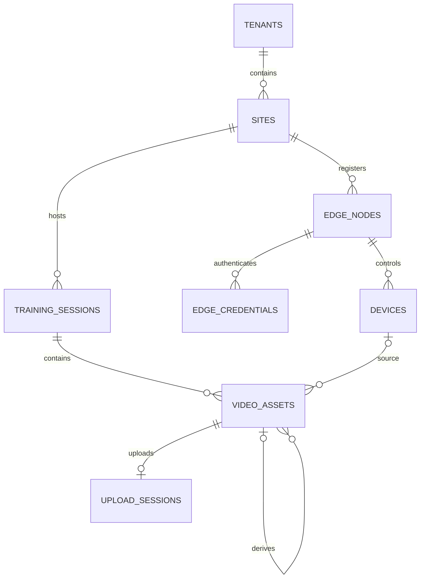

# Design

## Context

动机与交付范围见[提案](proposal.md)。初稿 2026-11-08，修订 2026-11-09（Asia/Shanghai），基线 `main@afb0e5f`。负责人于 2026-11-09 第二轮 Proposal 技术审阅通过并批准以下 D1–D10 作为 v0.1 文档设计方向，随后授权纯文档 Apply。此授权不代表四实体已有表、接口或运行证据，也不批准业务实施。

| 已核对来源 | 事实与边界 |
| --- | --- |
| [模型](../../../services/cloud/src/swimplatform/models.py)、[原迁移](../../../services/cloud/migrations/versions/20261106_0001_cloud_identity.py) | 当前六表；sites 的 `(tenant_id,id)` 唯一键与 site_memberships 复合外键可作归属模式参考；本 change 不增表、不改 revision |
| [基础API](../../../docs/contracts/cloud-foundation.md)、[RBAC](../../../docs/contracts/cloud-rbac.md) | 19个HTTP操作，业务错误 `detail{code,message}`，现有owner/admin/coach/athlete；现有列表无分页/幂等，不能顺带改造 |
| [领域模型](../../../docs/architecture/cloud-domain-model.md)、cloud-identity主规格 | 四实体仍未实现；当前主规格10项要求不包含采集/媒体；文档change沿用skip_specs |
| [Notion 07](https://www.notion.so/410f602574aa81cda7bff8c3ed483f4d) §1/§3/§6/§7，状态草稿 | 实体表含TrainingSession、AnalysisTask，没有TrainingTask；API域有/training-tasks；媒体描述upload_session、分片续传、整对象校验，任务创建支持幂等键 |
| [Notion 03](https://www.notion.so/410f602574aa8170b565f7fc4c5eab30) §2/§3/§6，状态草稿 | 有训练任务/Edge分配、未来角色及顶层域路径示例；不是既有四角色政策已经扩展的证据 |

## Goals / Non-Goals

**Goals:** 为四实体给出可评审、相互吻合的归属、来源、历史、生命周期、权限与API建议；按真实评审结论在后续文档apply交付三份草案及接线说明。文档应足以暴露取舍，不能保证“后续只补字段、无需再评审关系”。

**Non-Goals:** 本 change 只创建文档草案，不实现业务代码、DDL、迁移、OpenAPI快照或运行测试；不选存储产品、不部署、不实施RLS。Pool/Lane、业务档案、TrainingTask/训练编排、AnalysisTask/分析结果、Outbox/Inbox、具体离线同步协议及Web均另行提案；不排除Edge离线生成临时记录的业务场景。

EdgeCredential、UploadSession是解释认证与上传的支持概念；资源显式授权仅约定访问语义，授权记录是否独立建表由业务实施设计决定。MediaBlob可能用于物理内容复用，但是否独立建表、如何引用和清理也留待业务实施。本change不落地这些表、幂等存储、校验worker或离线同步协议。

## 来源对照 C1–C5

下表记录来源核对和评审通过的处理口径；Notion 草稿是来源而非既有实现证据。负责人已批准 D1–D10 当前设计方向；具体未决实施参数仍留后续业务 Change，不反向扩大本 change。

| 编号 | 原来源与差异 | 本次推荐及对应设计 |
| --- | --- | --- |
| C1 上传 | Notion07 §6及[分片上传任务](https://www.notion.so/410f602574aa8129ab07d088ad80aa5b)明确分片、断点续传、SHA-256和确认；原初稿只写一次PUT不足以承接 | D6将UploadSession、分片签名/进度恢复、整对象校验列入文档契约，不降级验收 |
| C2 任务边界 | Notion07实体表没有TrainingTask，§3有/training-tasks；Notion03 §2有训练任务与Edge分配 | D4定义云端最终业务Session，不排斥Edge离线临时记录；训练编排、离线映射/同步另提案，TrainingTask与AnalysisTask不是同义概念 |
| C3 泳池/泳道 | Notion03与[组织模型任务](https://www.notion.so/410f602574aa818c85a9d73478666867)包含Pool/Lane | D1本草案只引用Site；记录后续组织模型扩展需求，不提前发布没有目标实体的lane_id字段 |
| C4 路径/角色 | Notion03/07是域划分与顶层路径草稿，角色多于现有四角色 | D3/D8沿用四角色；Owner/Admin在本机构管理，coach还需自己创建或资源级显式授权，场馆访问不等于视频访问；原19操作不变 |
| C5 幂等 | Notion07 §7要求任务创建支持Idempotency-Key；不是所有接口均已具备幂等的事实 | D7分离请求幂等、逻辑VideoAsset身份、物理文件内容复用；同SHA-256不合并采集来源，一次性凭据有显式例外，MediaBlob物理设计另议 |

## 模型概览（评审通过的文档方向；v0.1 draft，未实施）

| 关系/不变量 | 推荐约束及可空性 | 生命周期含义 |
| --- | --- | --- |
| Site → EdgeNode | `(tenant_id,site_id)` → sites；节点增加唯一 `(tenant_id,site_id,id)` | tenant/site创建后不可改；停用不删历史 |
| EdgeNode → Device | 必填 `(tenant_id,site_id,edge_node_id)` → edge_nodes；Device唯一 `(tenant_id,site_id,edge_node_id,id)` | 节点、场馆与机构绑定不可改；同一物理相机迁移后重新登记新ID |
| EdgeNode → EdgeCredential | 支持记录带tenant/site/edge_node_id，复合引用节点；token_hash唯一 | 每次验证节点启用状态及凭据有效/撤销状态；不是用户会话 |
| Site → TrainingSession | `(tenant_id,site_id)` → sites；会话唯一 `(tenant_id,site_id,id)` | 会话不绑定单节点；机构/场馆不可改，云端记录可信创建主体；Edge离线临时记录须待后续同步校验/映射，不能仅信任上报的创建者 |
| Session → VideoAsset | 必填 `(tenant_id,site_id,session_id)` → training_sessions | 一个会话多机位多资产；资产不迁移到另一会话 |
| Device → VideoAsset | 设备来源时 `(tenant_id,site_id,source_edge_node_id,source_device_id)` → devices 对应唯一键 | Edge上传必须匹配当前凭据节点；人工上传两项来源均为空；派生沿用父来源；不同设备/不同采集记录即使SHA-256相同，也保留独立asset_id、来源与采集时间 |
| VideoAsset → 父资产 | 可空 `(tenant_id,site_id,session_id,derived_from_asset_id)` → video_assets 对应唯一键 | 父资产必须同会话且ready，禁止自引用；只允许创建时指向已存在ready父资产且不再改父引用，避免形成环；状态/环检查不冒充纯FK保证 |
| VideoAsset → UploadSession | 支持记录绑定tenant/site/session/asset及发起用户或节点（两种主体恰选一），asset绑定唯一 | 人工/Edge上传每资产一会话，派生资产不在本轮生产；失败新意图建新资产，不把上传会话ID当设备授权 |

人工与Edge上传都使用UploadSession；派生关系仅定义元数据与隔离边界，转码/分析执行与派生资产生产接口不在本轮API建议内。资产创建时归属和来源即固定，ready后对象内容与校验信息也固定；内容变更产生新资产。支持记录的完整字段/约束建议在文档apply展开，本表不是可执行DDL。

## Decisions

### D1：固定首版归属，搬迁通过重新登记表达

推荐节点tenant/site、Device的tenant/site/edge_node_id、Session的tenant/site、Asset的tenant/site/session均不可修改；PATCH只接受明确可变字段，不能借ID变更迁移历史。搬迁硬件时撤销旧节点凭据、停用旧登记，在目标场馆建立新节点/设备ID；旧会话、录像和来源继续引用旧ID。跨机构搬迁也不重新归属旧录像。

**替代：** 原地更新并级联site会改写历史或被复合FK拒绝；完整部署历史表可表达更丰富移动，但超出本次四实体契约，另开组织/部署变更。首版不在PATCH暴露迁场馆功能，非法归属字段属于422输入拒绝，不发明删除冲突。

### D2：节点身份与来源链同时可追溯

EdgeNode代表软件身份、凭据、配置版本及心跳；Device代表其下的摄像头/传感器，挂接必填。Asset用source_edge_node_id/source_device_id记录实际来源，Edge请求不能自报另一节点的device_id；人工上传没有设备来源，派生资产继承父来源，不伪造采集设备。origin取edge/manual/derived，与来源字段和父引用有一致性约束。

**替代：** 把设备并入节点不能表达多机位；只凭同场馆允许任意节点替他人确认上传，会放宽设备凭据范围；只记asset.device_id而不说明来源约束难以审查历史与认证关系。

### D3：用户与Edge权限分开，凭据明文只发一次

用户侧先经过identity → membership → manager/site_access，再做Session/Asset资源级检查。节点、设备、凭据管理及显式资源授权管理只给owner/admin；Owner/Admin保持本机构管理范围，可访问该机构内Session/Asset，但不能跨机构。athlete暂不开放，教练—学员授权关系尚未建立，不能将场馆成员关系或SiteMembership当作该场馆全部训练视频的授权。这是新增资源的草案政策，既有接口不变。

coach必须同时具备当前机构成员关系、场馆访问权和下列资源条件：

- Session读取：自己创建，或Owner/Admin对该Session给予有效的显式读取授权。创建者由可信云端身份记录，客户端不能自填他人ID取得所有权。Session列表只返回符合条件的记录。
- Asset读取/播放：自己创建、被显式授权该Asset，或可按上一条读取所属Session。Session读取权限明确包含其现有及后续资产；Asset单独授权只开放该资产，不反向开放Session详情或其他资产。通过Session路径列资产须先有Session读取权；单独授权的Asset可从资产详情路径访问。
- Session管理：Owner/Admin或仍具场馆访问权的Session创建coach可修改状态、发起人工上传；只有Session读取授权不自动获得状态修改/上传权限。coach不能转授权；Owner/Admin可授予或撤销资源读取授权，授权对象须是本机构且有该场馆访问权的coach。

记Session读取范围为S-read、Session管理范围为S-manage、Asset读取范围为A-read，D8逐端点引用。每次请求重查当前成员/角色、场馆权限和有效资源授权，撤销后拒绝新签发播放URL；若自己创建或另一项有效授权仍提供同资源访问，则按剩余合法路径判断，不把撤销一条授权虚构为覆盖所有访问路径。角色/成员或场馆权限失效时，即使持有资源ID/旧grant也不能放行。Asset/Session列表、详情、子列表、播放签发及游标分页均使用同一过滤规则，不暴露未授权记录或数量。

Edge凭据绑定不可变节点归属，仅限心跳和自己发起的上传流程；既不能调用用户API，也不能修改Session全局状态。每次认证检查节点启用、凭据有效/未撤销；涉及上传时另外检查来源设备启用、上传发起节点与目标归属。未认证返回401 edge_unauthorized，不泄露凭据是否存在；有效身份遇到资源停用/终态冲突则在文档中单列状态错误，不混为凭据不存在。

注册节点只返回节点元数据，单独POST credentials签发明文；只存摘要、明文不写日志或幂等缓存。凭据签发重试的例外见D7。旧凭据推荐立即撤销后失效，不自动承诺宽限期；未来若要轮换重叠窗口，另行评审并更新契约。

**替代：** 机器人用户bearer会混淆授权域；mTLS需要证书生命周期，作为后续加固选择，不在本change选型。

### D4：Session以云端为最终业务权威，兼容Edge离线临时记录

会话属于Site而不是单节点，多设备通过各自Asset汇聚。推荐planned → recording → completed、planned/recording → cancelled；completed/cancelled为终态。云端是Session最终业务权威，当前云端状态变更API由D3的S-manage主体调用；只获得读取授权的coach不能推进状态。Edge上报观测和确认自己的上传，不凭单个节点上报直接结束全局Session，避免节点A结束节点B仍在录制的多机位训练。

这不排斥Edge在离线期间生成临时本地训练/采集记录并保存录像，也不要求设备必须先在线创建云端Session才可采集。本地临时ID、观测状态和创建主体声明不是自动获云端承认的最终Session记录；恢复联网后可同步，云端在后续同步Change定义的身份/资源授权、归属、ID映射、重复记录和状态冲突规则下接纳或拒绝。此处不规定离线传输、Outbox/Inbox、映射算法或冲突协议。

推荐recording/completed允许云端创建上传意图；planned/cancelled拒绝当前云端新上传或完成确认。这是云端API前置，不是禁止Edge离线采集的规则。取消和上传确认要有明确事务先后：先取消则不能新置ready；先ready则既有资产保留可追溯。已完成会话允许合规补传，不因此回退状态。多节点自动收尾、训练计划/分配、学员关系及离线记录的接纳另行提案。

**替代：** 把Session强绑一个节点会限制换机和多机位；把TrainingTask与AnalysisTask合并会混淆计划执行与离线分析；首版增加采集分配表/自动完成协议将扩大业务范围。

### D5：资产内容不可变，派生链不跨归属

Asset归属与来源从创建起不可变；pending_upload → ready或failed，ready/failed为终态，失败重试用新的上传意图和资产ID，不覆盖原对象。派生父资产同tenant/site/session且必须ready，另生成新资产，不能借derived_from_asset_id跨机构或跨场馆取原件。

资产访问必须满足D3的A-read资源范围，场馆可访问只是前置，不是全场馆视频授权；Session是否completed/cancelled也不额外授予读取权。既有ready资产依然逐次检查授权；相同字节的不同逻辑资产各自保留来源、归属及授权，不得只凭对象Key、checksum、物理对象复用关系或裸asset_id放行。

**替代：** 原件覆盖和可变父引用会使分析输入无法追溯；允许跨会话派生/复用需要单独设计共享授权，不在首版默认开放。

### D6：分片上传、恢复与服务端完整性确认

推荐协议：创建UploadSession和pending Asset → 获取限定对象/分片的短时签名 → 直传分片 → 查询已确认分片恢复 → complete请求合并与校验 → 校验成功才ready。UploadSession取uploading/completing/completed/failed/aborted/expired；completing可返回202，查询显示结果，completed重试返回同一ready Asset，不重复合并。客户端分片回执不是整对象已完整的证据。

服务端独立核实整对象bytes/SHA-256及媒体元数据，不信任客户端上报duration；存储无法提供可信整对象校验时，后续实施必须提供校验worker等能力，不能降低为“分片上传成功即ready”。失败返回明确code并记录上传/资产终态；中止/过期后不允许complete，停止签发新URL；已签URL仍可能在有效期内传入对象，这些对象不得成为ready且需后续清理策略回收。

预签名限定对象、HTTP动作、分片编号和适用校验条件，不提供桶任意访问；文档给出有效期上限。具体存储产品、分片大小/数量和清理期限是业务实施前置，不阻止文档描述状态与协议。

**替代：** 单次PUT不满足已有分片续传任务；应用进程代理全部媒体或永久公开URL不作为推荐方案。

### D7：分离请求幂等、逻辑资产身份与物理内容复用

仅新增资源创建、上传意图/complete定义Idempotency-Key：作用域为tenant/site、已认证主体、HTTP操作及目标资源；同键同参复用原资源/当前状态，同键异参409 idempotency_conflict，并发同键只产生一个资源。缓存不绕过重新认证/授权，不能把另一主体结果重放出来。有效期及过期键处理须在业务实施前确定并写契约。

一次性凭据签发是显式例外：同键重试不再签发也不重放明文，返回409 credential_secret_not_replayable及本来有权限查看的credential_id；用户可查询/撤销该凭据后用新键签发。幂等记录只保存摘要/资源标识，禁止保存凭据明文。

逻辑VideoAsset由asset_id标识一次独立的采集/导入/派生记录，保留tenant/site/session、来源节点/设备、采集时间及创建主体。经确认是同一请求的幂等重试才复用已创建的逻辑资源；不同设备的视频、同一设备的不同采集或独立人工导入，即使整对象SHA-256相同也必须获得独立asset_id并保留各自来源，不能按tenant/session/checksum设逻辑资产唯一性、返回已有资产来替代它们或仅因内容相同拒绝创建。离线重传若要识别同一次采集，须依后续同步设计的来源采集标识与映射，不用hash猜测采集身份。

物理文件内容去重是存储层可选优化：底层即使复用相同字节，也不合并逻辑资产、采集来源、访问控制或生命周期。SHA-256用于完整性和物理内容比较，不是资源授权依据或VideoAsset身份。MediaBlob是否独立建表、物理复用范围、对象引用/回收规则由后续业务实施设计决定；本change不建MediaBlob表，也不提前指定其唯一键。删除/清理一项逻辑引用不得毁掉仍被其他保留资产引用的物理内容，边界见D9。

**替代：** 所有POST无差别缓存响应会泄露一次性密钥；把相同checksum当相同VideoAsset会丢失多设备/多次采集来源，存储优化也不能替代请求幂等。

### D8：完整路径、稳定分页及错误边界

用户前缀P=`/api/v1/tenants/{tenant_id}/sites/{site_id}`，Edge前缀E=`/api/v1/edge`。下表只列建议操作面，完整字段/状态码/错误表在文档apply交付；node/device/session/asset参数统一采用完整实体名，不混用sid/node_id/aid。

| 推荐操作 | 身份与范围 | 结果/边界 |
| --- | --- | --- |
| GET/POST P/edge-nodes；GET/PATCH P/edge-nodes/{edge_node_id} | owner/admin | 注册201仅元数据；查询/更新200，归属字段不可变 |
| GET/POST P/edge-nodes/{edge_node_id}/credentials；DELETE P/edge-nodes/{edge_node_id}/credentials/{credential_id} | owner/admin | 查询仅摘要元数据；签发201且明文一次；撤销204，这是凭据撤销而非节点删除 |
| GET/POST P/devices；GET/PATCH P/devices/{device_id} | owner/admin | 创建201；挂接只能是同归属节点，后续不可改 |
| GET P/training-sessions；GET P/training-sessions/{session_id} | S-read；列表按S-read过滤 | 200；仅有场馆访问权而无资源读取权时详情404，列表不返回该会话 |
| POST P/training-sessions；PATCH P/training-sessions/{session_id} | 创建为owner/admin或有场馆访问权的coach；修改为S-manage | 创建201且可信记录创建者；修改200/状态冲突409，单纯读取grant不授予管理权 |
| GET P/training-sessions/{session_id}/video-assets；GET P/video-assets/{asset_id} | 会话子列表先校验S-read并按A-read返回；单资产按A-read | 元数据200；单个Asset授权不解锁其Session或兄弟资产；Owner/Admin限本机构 |
| POST P/video-assets/{asset_id}/playback-url | A-read且资产ready | 200；教练自己的/显式授权资源，禁止凭SiteMembership签全场馆视频URL |
| PUT/DELETE P/training-sessions/{session_id}/read-grants/{user_id}；PUT/DELETE P/video-assets/{asset_id}/read-grants/{user_id} | 仅owner/admin；接收者是同机构有该场馆访问权的coach | 授予/撤销204；Session grant含其资产，Asset grant只含该资产，不授予状态管理或转授权；这里只约定API语义，不决定授权表实现 |
| POST P/training-sessions/{session_id}/upload-sessions | S-manage | 人工上传意图201，无设备来源；可信记录发起用户作为Asset创建者 |
| POST E/heartbeat | 有效Edge凭据 | 200，仅本节点；注册/设备配置不从心跳任意扩权 |
| POST E/sessions/{session_id}/upload-sessions | 有效Edge凭据及本节点Device | 上传意图201，记录发起节点和来源；Session必须同场馆 |
| GET P/upload-sessions/{upload_session_id}；POST其/part-urls、/complete、/abort | 仍具S-manage且为原发起用户 | 恢复200、分片签名200、完成202/200、中止204；读grant不授予续传，机构资源管理权也不等于借他人的上传主体/幂等结果操作 |
| GET E/upload-sessions/{upload_session_id}；POST其/part-urls、/complete、/abort | 原发起节点及有效凭据 | 同上；不同节点即使同场馆也不可确认或中止 |

Session/Asset列表用不可变(created_at,id)游标，planned.started_at可空不作排序键；cursor绑定tenant/site/过滤条件并重新验证当前主体/资源范围，不能通过旧游标绕过撤权；先过滤再计算返回项和可见分页信息，limit建议默认20/上限100。其他新列表是否有必要分页在文档中明确，不改原19操作。所有新业务错误沿用detail对象；401身份失败、404非成员/非授权资源、403机构内角色或管理权限不足、409状态/幂等冲突、422格式/禁止字段，具体检查优先级逐端点对照既有契约。

播放URL建议最长5分钟，撤权/停用后拒绝新签发；已发URL在到期前可能继续有效，不宣称即时失效。要求即时撤销或在线播放代理时另行设计，不用隐藏TTL满足“立即撤销”承诺。

**替代：** started_at可空/可变会破坏分页；把新资源分页规则套到旧列表会引入兼容性变化。

### D9：不提供四实体DELETE，不虚构删除409

首版节点/设备只停用、Session只取消，Asset无删除；不定义节点删除API或edge_node_in_use删除错误。凭据撤销、UploadSession中止不是删除四实体，契约必须分开。未来资源保留/软删/硬删需与审计、授权和历史引用一起评审；现有父表CASCADE也不直接复制为未来媒体清理方案。

此约束也覆盖父级Site/Tenant的生命周期：未来接入Session/Asset后，不能经删除场馆或机构级联抹掉历史录像、来源和授权追溯。存在历史资产、活动引用或未满足保留/处置条件时，不得硬删除父记录或移除归属链；推荐先停用/归档并保留稳定ID。后续业务实施须评审外键删除行为与保留、授权访问/导出、审计、合法清理流程，不把当前六表的CASCADE自动延伸到媒体。

只有按后续批准的保留与处置策略才可物理清理；如底层内容被多个逻辑资产引用，还必须确认没有其他应保留引用，不能清理一项逻辑资产就删除共享文件。本轮不新增Site/Tenant删除接口、不改现有外键或迁移，也不选定保留期限。

**替代：** 公开级联删除会毁掉历史来源；没有DELETE却写“删除时409”会让客户端调用不存在的操作。

### D10：区分云端元数据权威与本地原件留存

注册、身份、归属及Session最终业务状态以云端为权威；Edge在断网期间可生成临时本地Session/采集记录和录像，在恢复联网后同步，云端依据后续Change定义的授权、ID映射和冲突规则形成最终记录。云端权威不等于每次本地录制都必须事先在线，也不等于Edge临时状态可直接覆盖云端终态；本轮不定义具体离线协议。

设备提供采集时间及设备时钟来源，云端保存来源与不确定性，不能用接收时间或入库时间冒充拍摄时间，也不能把一次上传校验当作设备时钟已准确对齐。文档字段设计需区分采集起止、视频相对时间基准与UTC/本地时间映射、原始设备时间和时区/偏移、clock source（如NTP/PTP/GPS/手动/未知）、可空的校时偏差/精度，以及服务端接收/创建时间；未知值显式表示，不臆造精确UTC。跨机位校准算法与离线协议留后续，但字段来源和可空性属于本次文档设计要求。

本地原件在采集设备保存，云端验证ready只证明该对象的完整副本可用，不自动把本地原件降级为可删缓存。必须另满足保留策略和云端确认才可清理，本change不发删除指令。

节点config_revision由云端维护，applied_config_revision由心跳上报，只表达配置漂移；不定义完整配置下发、权限快照或双向事件协议。节点pending → active、pending/active → disabled及disabled → active都由owner/admin操作；停用即阻断Edge调用并撤销已有凭据，重新启用须新签发，旧凭据不复活。Device允许active/disabled间由owner/admin切换，停用后不允许新上传/确认，历史资产访问仍按D3/D5；节点业务状态与在线/离线健康观测分开，心跳不能重启已停用权限。

**替代：** 以ready自动删除本地原件违背Notion分片任务的留存要求；一次设计Outbox/Inbox会扩大本change。

## Notion追溯与任务映射

| 原任务 | 本change角色 | 设计/文档任务 | 阶段与排除范围 |
| --- | --- | --- | --- |
| [数据模型P0](https://www.notion.so/410f602574aa811bbad3c6e452a065b6) | 直接交付文档子范围 | D1/D2/D4/D5/D9/D10；0.1、1.1、1.2、3.1、3.2、4.1 | 总体进行中，不包含未来实体和生产迁移 |
| [架构/API P0](https://www.notion.so/410f602574aa816582ccc14817ce4601) | 直接交付文档子范围 | D3/D6/D7/D8；0.1、2.1–2.3、3.1、4.1–4.3 | 总体进行中，不冻结全平台API |
| [媒体授权P0](https://www.notion.so/410f602574aa811094bec51f53fe50e3) | 提供前置 | D2/D3/D5/D6/D8/D9 | 保持未开始，本次不实现播放/上传 |
| [Edge注册P1](https://www.notion.so/410f602574aa81e9bfa5cb7ca947e7f7) | 提供前置 | D1–D3/D8/D10 | 保持待确认，无设备接入运行证据 |
| [分片上传P1](https://www.notion.so/410f602574aa8129ab07d088ad80aa5b) | 提供前置 | C1、D6/D7/D10 | 保持待确认，不把草案当已完成续传 |
| [组织模型P1](https://www.notion.so/410f602574aa818c85a9d73478666867) | 依赖/排除扩展 | C3、D1 | Pool/Lane留后续，本次不建表或字段 |

## Risks / Trade-offs

- [设计方向获评审但尚未实施] → ADR记录第二轮Proposal审阅结论；业务实现仍需独立Change、规格和权限/运行验证，不外推为生产架构。
- [支持概念被误当扩张] → EdgeCredential/UploadSession及资源显式授权只约定必要语义；MediaBlob/授权记录是否独立建表、幂等存储和完整性实现另由业务change设计。
- [草案与实施漂移] → 业务实施提案先diff三份文档与ADR，并在实施前写行为规格与新增迁移，不改已发布revision。
- [失效签名仍可传入/播放] → 限定短期URL，明确不能即时撤回，禁止失效上传变ready；后台清理参数另评审，不删除本地原件。
- [请求重试/逻辑资产/物理复用混淆] → 同键重试与独立采集分开；不同设备同SHA仍保留独立asset_id和来源，物理复用不共享授权；未来业务change提供并发与负向证据。
- [场馆权限扩张为全场录像权限] → coach逐请求校验S-read/S-manage/A-read；列表/详情/播放/游标及读grant撤销均核对，单个Asset grant不开放其他资产。

## Migration Plan

1. Propose 阶段在提交 c07f20e 发布规划；负责人第二轮审阅后明确授权文档 Apply。
2. 本次文档 Apply 新增三份草案、Apply 交叉核对记录并更新既有领域模型的未来实体接线；回退为文档回退，不新增 revision、代码、OpenAPI 或依赖。
3. 后续业务实施另开change，先落实存储/校验/清理能力及批准的协议，再提出行为规格、数据库身份/迁移/约束和测试，不从本设计直接执行建表顺序。

## Open Questions

以下为后续业务实施前置，不改变本次三份文档与接线任务；文档apply应记录“未决/不得投入业务实施”，而非擅自选定：

- 对象存储供应商/区域、可信整对象校验与媒体解析能力、开发适配后端。
- 分片大小/数量、URL与幂等记录的配置期限、孤儿对象和本地原件保留/回收参数；不得放宽D6/D8的安全边界。
- 学员参与关系、Pool/Lane、训练计划/Edge自动编排、多机位时钟对齐算法及离线记录同步协议由各自提案承接；本次仍设计采集时间/基准/时钟来源字段。
- MediaBlob是否独立建表、物理内容复用与清理实现、资源显式授权记录的物理模型，由业务实施设计确定，不在本Change建表。

D1–D10方向已获负责人第二轮 Proposal 技术审阅通过；Open Questions 记录的是未决实施参数，不是对已通过方向的保留或新的架构承诺。业务实施须由另一个 Change 明确授权。
