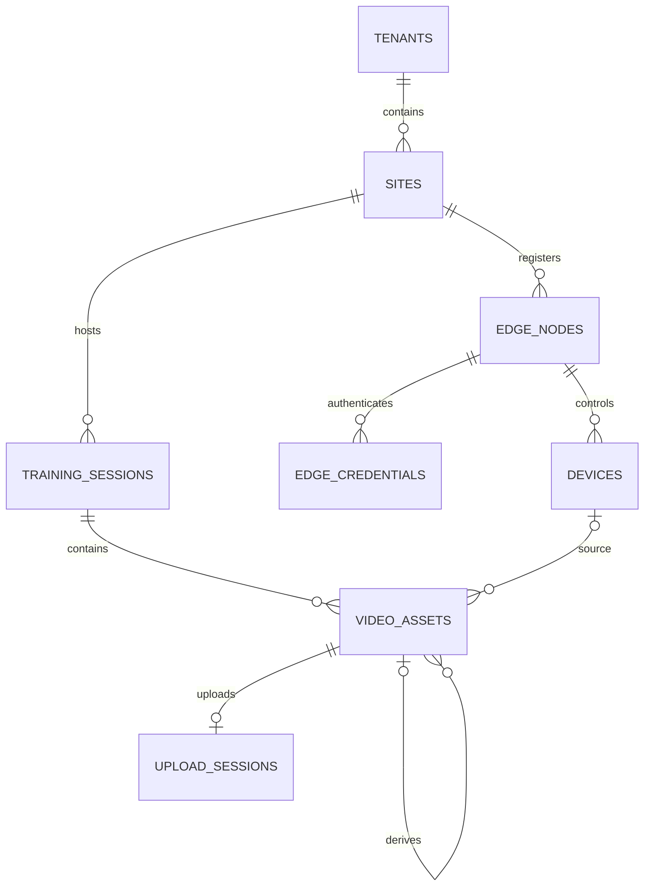

# Design

## Context

动机与交付范围见[提案](proposal.md)。初稿 2026-11-08，修订 2026-11-09（Asia/Shanghai），基线 `main@afb0e5f`。本 change 只规划领域/API/ADR文档；以下 D1–D10 是供负责人评审的推荐方案，尚未获架构批准或文档 apply 授权，不代表四实体已有表、接口或运行证据。

| 已核对来源 | 事实与边界 |
| --- | --- |
| [模型](../../../services/cloud/src/swimplatform/models.py)、[原迁移](../../../services/cloud/migrations/versions/20261106_0001_cloud_identity.py) | 当前六表；sites 的 `(tenant_id,id)` 唯一键与 site_memberships 复合外键可作归属模式参考；本 change 不增表、不改 revision |
| [基础API](../../../docs/contracts/cloud-foundation.md)、[RBAC](../../../docs/contracts/cloud-rbac.md) | 19个HTTP操作，业务错误 `detail{code,message}`，现有owner/admin/coach/athlete；现有列表无分页/幂等，不能顺带改造 |
| [领域模型](../../../docs/architecture/cloud-domain-model.md)、cloud-identity主规格 | 四实体仍未实现；当前主规格10项要求不包含采集/媒体；文档change沿用skip_specs |
| [Notion 07](https://www.notion.so/410f602574aa81cda7bff8c3ed483f4d) §1/§3/§6/§7，状态草稿 | 实体表含TrainingSession、AnalysisTask，没有TrainingTask；API域有/training-tasks；媒体描述upload_session、分片续传、整对象校验，任务创建支持幂等键 |
| [Notion 03](https://www.notion.so/410f602574aa8170b565f7fc4c5eab30) §2/§3/§6，状态草稿 | 有训练任务/Edge分配、未来角色及顶层域路径示例；不是既有四角色政策已经扩展的证据 |

## Goals / Non-Goals

**Goals:** 为四实体给出可评审、相互吻合的归属、来源、历史、生命周期、权限与API建议；按真实评审结论在后续文档apply交付三份草案及接线说明。文档应足以暴露取舍，不能保证“后续只补字段、无需再评审关系”。

**Non-Goals:** 本轮不创建正式交付文档、业务代码、DDL、迁移、OpenAPI快照或运行测试；不选存储产品、不部署、不实施RLS。Pool/Lane、业务档案、TrainingTask/训练编排、AnalysisTask/分析结果、Outbox/Inbox、离线同步及Web均另行提案。

EdgeCredential、UploadSession是解释认证与上传的支持概念，不作为额外业务领域偷偷落地；幂等记录、存储适配及校验worker的物理实现留给后续业务change。

## 来源对照 C1–C5

下表是来源核对与本提案的推荐口径，不是已收到的负责人裁决。不存在的来源内容已纠正；推荐范围可随评审修订，不以“等五项全部答复”阻止发布Draft PR。

| 编号 | 原来源与差异 | 本次推荐及对应设计 |
| --- | --- | --- |
| C1 上传 | Notion07 §6及[分片上传任务](https://www.notion.so/410f602574aa8129ab07d088ad80aa5b)明确分片、断点续传、SHA-256和确认；原初稿只写一次PUT不足以承接 | D6将UploadSession、分片签名/进度恢复、整对象校验列入文档契约，不降级验收 |
| C2 任务边界 | Notion07实体表没有TrainingTask，§3有/training-tasks；Notion03 §2有训练任务与Edge分配 | D4仅定义实际训练Session；训练计划/分配属于后续训练编排，与AnalysisTask不是同义概念，不擅自归入分析流水线 |
| C3 泳池/泳道 | Notion03与[组织模型任务](https://www.notion.so/410f602574aa818c85a9d73478666867)包含Pool/Lane | D1本草案只引用Site；记录后续组织模型扩展需求，不提前发布没有目标实体的lane_id字段 |
| C4 路径/角色 | Notion03/07是域划分与顶层路径草稿，角色多于现有四角色 | D3/D8推荐用户侧tenant/site嵌套、Edge专属前缀；沿用四角色，逐端点说明新增资源访问限制，不宣称原19操作都采用同一种路径 |
| C5 幂等 | Notion07 §7要求任务创建支持Idempotency-Key；不是所有接口均已具备幂等的事实 | D7仅在新资源创建、上传意图/完成操作定义重试语义；内容checksum去重另列，一次性凭据明确例外，不改既有接口 |

## 模型概览（推荐，待评审）

| 关系/不变量 | 推荐约束及可空性 | 生命周期含义 |
| --- | --- | --- |
| Site → EdgeNode | `(tenant_id,site_id)` → sites；节点增加唯一 `(tenant_id,site_id,id)` | tenant/site创建后不可改；停用不删历史 |
| EdgeNode → Device | 必填 `(tenant_id,site_id,edge_node_id)` → edge_nodes；Device唯一 `(tenant_id,site_id,edge_node_id,id)` | 节点、场馆与机构绑定不可改；同一物理相机迁移后重新登记新ID |
| EdgeNode → EdgeCredential | 支持记录带tenant/site/edge_node_id，复合引用节点；token_hash唯一 | 每次验证节点启用状态及凭据有效/撤销状态；不是用户会话 |
| Site → TrainingSession | `(tenant_id,site_id)` → sites；会话唯一 `(tenant_id,site_id,id)` | 会话不绑定单节点；机构/场馆不可改，创建者是云端用户 |
| Session → VideoAsset | 必填 `(tenant_id,site_id,session_id)` → training_sessions | 一个会话多机位多资产；资产不迁移到另一会话 |
| Device → VideoAsset | 设备来源时 `(tenant_id,site_id,source_edge_node_id,source_device_id)` → devices 对应唯一键 | Edge上传必须有匹配当前凭据节点的来源设备；人工上传两项来源字段均为空；派生资产沿用父资产来源 |
| VideoAsset → 父资产 | 可空 `(tenant_id,site_id,session_id,derived_from_asset_id)` → video_assets 对应唯一键 | 父资产必须同会话且ready，禁止自引用；只允许创建时指向已存在ready父资产且不再改父引用，避免形成环；状态/环检查不冒充纯FK保证 |
| VideoAsset → UploadSession | 支持记录绑定tenant/site/session/asset及发起用户或节点（两种主体恰选一），asset绑定唯一 | 人工/Edge上传每资产一会话，派生资产不在本轮生产；失败新意图建新资产，不把上传会话ID当设备授权 |

人工与Edge上传都使用UploadSession；派生关系仅定义元数据与隔离边界，转码/分析执行与派生资产生产接口不在本轮API建议内。资产创建时归属和来源即固定，ready后对象内容与校验信息也固定；内容变更产生新资产。支持记录的完整字段/约束建议在文档apply展开，本表不是可执行DDL。

## Decisions

### D1：固定首版归属，搬迁通过重新登记表达

推荐节点tenant/site、Device的tenant/site/edge_node_id、Session的tenant/site、Asset的tenant/site/session均不可修改；PATCH只接受明确可变字段，不能借ID变更迁移历史。搬迁硬件时撤销旧节点凭据、停用旧登记，在目标场馆建立新节点/设备ID；旧会话、录像和来源继续引用旧ID。跨机构搬迁也不重新归属旧录像。

**替代：** 原地更新并级联site会改写历史或被复合FK拒绝；完整部署历史表可表达更丰富移动，但超出本次四实体契约，另开组织/部署变更。首版不在PATCH暴露迁场馆功能，非法归属字段属于422输入拒绝，不发明删除冲突。

### D2：节点身份与来源链同时可追溯

EdgeNode代表软件身份、凭据、配置版本及心跳；Device代表其下的摄像头/传感器，挂接必填。Asset用source_edge_node_id/source_device_id记录实际来源，Edge请求不能自报另一节点的device_id；人工上传没有设备来源，派生资产继承父来源，不伪造采集设备。origin取edge/manual/derived，与来源字段和父引用有一致性约束。

**替代：** 把设备并入节点不能表达多机位；只凭同场馆允许任意节点替他人确认上传，会放宽设备凭据范围；只记asset.device_id而不说明来源约束难以审查历史与认证关系。

### D3：用户与Edge权限分开，凭据明文只发一次

用户侧复用identity → membership → manager/site_access。节点、设备及凭据管理只给owner/admin；Session/Asset的建议访问角色为owner/admin或具场馆授权的coach，athlete暂不开放，原因是尚无训练参与关系，不能用场馆成员关系冒充“本人训练”。这是新增资源的推荐政策，需负责人评审，不是已实现授权。

Edge凭据绑定不可变节点归属，仅限心跳和自己发起的上传流程；既不能调用用户API，也不能修改Session全局状态。每次认证检查节点启用、凭据有效/未撤销；涉及上传时另外检查来源设备启用、上传发起节点与目标归属。未认证返回401 edge_unauthorized，不泄露凭据是否存在；有效身份遇到资源停用/终态冲突则在文档中单列状态错误，不混为凭据不存在。

注册节点只返回节点元数据，单独POST credentials签发明文；只存摘要、明文不写日志或幂等缓存。凭据签发重试的例外见D7。旧凭据推荐立即撤销后失效，不自动承诺宽限期；未来若要轮换重叠窗口，另行评审并更新契约。

**替代：** 机器人用户bearer会混淆授权域；mTLS需要证书生命周期，作为后续加固选择，不在本change选型。

### D4：Session是实际训练，由云端角色推进状态

会话属于Site而不是单节点，多设备通过各自Asset汇聚。推荐planned → recording → completed、planned/recording → cancelled；completed/cancelled为终态。开始、结束、取消都由D3中的云端授权用户执行。Edge只报告状态和确认自己的上传，不提供Edge结束整个Session的端点；避免节点A因已有一条ready录像就结束节点B仍在录制的多机位训练。

推荐recording/completed允许创建上传意图；planned/cancelled拒绝新上传或完成确认。取消和上传确认要有明确事务先后：先取消则不能新置ready；先ready则既有资产保留可追溯。已完成会话允许补传，不因此回退状态。多节点自动收尾、训练计划/分配和学员关系另行提案。

**替代：** 把Session强绑一个节点会限制换机和多机位；把TrainingTask与AnalysisTask合并会混淆计划执行与离线分析；首版增加采集分配表/自动完成协议将扩大业务范围。

### D5：资产内容不可变，派生链不跨归属

Asset归属与来源从创建起不可变；pending_upload → ready或failed，ready/failed为终态，失败重试用新的上传意图和资产ID，不覆盖原对象。派生父资产同tenant/site/session且必须ready，另生成新资产，不能借derived_from_asset_id跨机构或跨场馆取原件。

资产授权依赖所属场馆与D3角色，而不是Session是否completed；cancelled会话中的既有ready资产仍有权限校验。不得只凭对象Key、checksum或裸asset_id放行。

**替代：** 原件覆盖和可变父引用会使分析输入无法追溯；允许跨会话派生/复用需要单独设计共享授权，不在首版默认开放。

### D6：分片上传、恢复与服务端完整性确认

推荐协议：创建UploadSession和pending Asset → 获取限定对象/分片的短时签名 → 直传分片 → 查询已确认分片恢复 → complete请求合并与校验 → 校验成功才ready。UploadSession取uploading/completing/completed/failed/aborted/expired；completing可返回202，查询显示结果，completed重试返回同一ready Asset，不重复合并。客户端分片回执不是整对象已完整的证据。

服务端独立核实整对象bytes/SHA-256及媒体元数据，不信任客户端上报duration；存储无法提供可信整对象校验时，后续实施必须提供校验worker等能力，不能降低为“分片上传成功即ready”。失败返回明确code并记录上传/资产终态；中止/过期后不允许complete，停止签发新URL；已签URL仍可能在有效期内传入对象，这些对象不得成为ready且需后续清理策略回收。

预签名限定对象、HTTP动作、分片编号和适用校验条件，不提供桶任意访问；文档给出有效期上限。具体存储产品、分片大小/数量和清理期限是业务实施前置，不阻止文档描述状态与协议。

**替代：** 单次PUT不满足已有分片续传任务；应用进程代理全部媒体或永久公开URL不作为推荐方案。

### D7：请求幂等与内容去重分别定义

仅新增资源创建、上传意图/complete定义Idempotency-Key：作用域为tenant/site、已认证主体、HTTP操作及目标资源；同键同参复用原资源/当前状态，同键异参409 idempotency_conflict，并发同键只产生一个资源。缓存不绕过重新认证/授权，不能把另一主体结果重放出来。有效期及过期键处理须在业务实施前确定并写契约。

一次性凭据签发是显式例外：同键重试不再签发也不重放明文，返回409 credential_secret_not_replayable及本来有权限查看的credential_id；用户可查询/撤销该凭据后用新键签发。幂等记录只保存摘要/资源标识，禁止保存凭据明文。

内容去重另按tenant/session/整对象SHA-256判定，确认时必须原子防重；不同请求键上传相同内容可返回409 asset_duplicate及同权限范围已有asset_id，不静默覆盖。待确认与失败对象的回收独立处理；不是用checksum代替请求重试控制。

**替代：** 所有POST无差别缓存响应会泄露一次性密钥；只按checksum去重不能防止创建节点、训练或上传意图时的网络重试。

### D8：完整路径、稳定分页及错误边界

用户前缀P=`/api/v1/tenants/{tenant_id}/sites/{site_id}`，Edge前缀E=`/api/v1/edge`。下表只列建议操作面，完整字段/状态码/错误表在文档apply交付；node/device/session/asset参数统一采用完整实体名，不混用sid/node_id/aid。

| 推荐操作 | 身份与范围 | 结果/边界 |
| --- | --- | --- |
| GET/POST P/edge-nodes；GET/PATCH P/edge-nodes/{edge_node_id} | owner/admin | 注册201仅元数据；查询/更新200，归属字段不可变 |
| GET/POST P/edge-nodes/{edge_node_id}/credentials；DELETE P/edge-nodes/{edge_node_id}/credentials/{credential_id} | owner/admin | 查询仅摘要元数据；签发201且明文一次；撤销204，这是凭据撤销而非节点删除 |
| GET/POST P/devices；GET/PATCH P/devices/{device_id} | owner/admin | 创建201；挂接只能是同归属节点，后续不可改 |
| GET/POST P/training-sessions；GET/PATCH P/training-sessions/{session_id} | D3云端角色 | 创建201；状态冲突409，设备不得调用 |
| GET P/training-sessions/{session_id}/video-assets；GET P/video-assets/{asset_id} | D3云端角色 | 元数据200，拒绝跨归属引用 |
| POST P/video-assets/{asset_id}/playback-url | D3云端角色 | 200；只对ready签发短期授权URL |
| POST P/training-sessions/{session_id}/upload-sessions | D3云端角色 | 人工上传意图201，无设备来源，记录发起用户 |
| POST E/heartbeat | 有效Edge凭据 | 200，仅本节点；注册/设备配置不从心跳任意扩权 |
| POST E/sessions/{session_id}/upload-sessions | 有效Edge凭据及本节点Device | 上传意图201，记录发起节点和来源；Session必须同场馆 |
| GET P/upload-sessions/{upload_session_id}；POST其/part-urls、/complete、/abort | D3角色且为原发起用户 | 恢复200、分片签名200、完成202/200、中止204；不能借ID接管其他用户上传 |
| GET E/upload-sessions/{upload_session_id}；POST其/part-urls、/complete、/abort | 原发起节点及有效凭据 | 同上；不同节点即使同场馆也不可确认或中止 |

Session/Asset列表用不可变(created_at,id)游标，planned.started_at可空不作排序键；cursor绑定tenant/site/过滤条件，limit建议默认20/上限100。其他新列表是否有必要分页在文档中明确，不改原19操作。所有新业务错误沿用detail对象；401身份失败、404非成员/非授权资源、403机构内角色不足、409状态/幂等冲突、422格式/禁止字段，具体检查优先级逐端点对照既有契约。

播放URL建议最长5分钟，撤权/停用后拒绝新签发；已发URL在到期前可能继续有效，不宣称即时失效。要求即时撤销或在线播放代理时另行设计，不用隐藏TTL满足“立即撤销”承诺。

**替代：** started_at可空/可变会破坏分页；把新资源分页规则套到旧列表会引入兼容性变化。

### D9：不提供四实体DELETE，不虚构删除409

首版节点/设备只停用、Session只取消，Asset无删除；不定义节点删除API或edge_node_in_use删除错误。凭据撤销、UploadSession中止不是删除四实体，契约必须分开。未来资源保留/软删/硬删需与审计、授权和历史引用一起评审；现有父表CASCADE也不直接复制为未来媒体清理方案。

**替代：** 公开级联删除会毁掉历史来源；没有DELETE却写“删除时409”会让客户端调用不存在的操作。

### D10：区分云端元数据权威与本地原件留存

注册、身份、归属、Session状态以云端为权威；本地原件在采集设备保存，云端验证ready只证明该对象的完整副本可用，不自动把本地原件降级为可删缓存。必须另满足保留策略和云端确认才可清理，本change不发删除指令。

节点config_revision由云端维护，applied_config_revision由心跳上报，只表达配置漂移；不定义完整配置下发、权限快照或双向事件协议。节点pending → active、pending/active → disabled及disabled → active都由owner/admin操作；停用即阻断Edge调用并撤销已有凭据，重新启用须新签发，旧凭据不复活。Device允许active/disabled间由owner/admin切换，停用后不允许新上传/确认，历史资产访问仍按D3/D5；节点业务状态与在线/离线健康观测分开，心跳不能重启已停用权限。

**替代：** 以ready自动删除本地原件违背Notion分片任务的留存要求；一次设计Outbox/Inbox会扩大本change。

## Notion追溯与任务映射

| 原任务 | 本change角色 | 设计/文档任务 | 阶段与排除范围 |
| --- | --- | --- | --- |
| [数据模型P0](https://www.notion.so/410f602574aa811bbad3c6e452a065b6) | 直接交付文档子范围 | D1/D2/D4/D5/D9/D10；0.1、1.1、1.2、3.1、3.2、4.1 | 总体进行中，不包含未来实体和生产迁移 |
| [架构/API P0](https://www.notion.so/410f602574aa816582ccc14817ce4601) | 直接交付文档子范围 | D3/D6/D7/D8；0.1、2.1–2.3、3.1、4.1–4.3 | 总体进行中，不冻结全平台API |
| [媒体授权P0](https://www.notion.so/410f602574aa811094bec51f53fe50e3) | 提供前置 | D2/D3/D5/D6/D8/D9 | 保持未开始，本次不实现播放/上传 |
| [Edge注册P1](https://www.notion.so/410f602574aa81e9bfa5cb7ca947e7f7) | 提供前置 | D1–D3/D8/D10 | 保持待确认，无设备接入运行证据 |
| [分片上传P1](https://www.notion.so/410f602574aa8129ab07d088ad80aa5b) | 提供前置 | C1、D6/D7/D10 | 保持待确认，不把草案当已完成续传 |
| [组织模型P1](https://www.notion.so/410f602574aa818c85a9d73478666867) | 依赖/排除扩展 | C3、D1 | Pool/Lane留后续，本次不建表或字段 |

## Risks / Trade-offs

- [推荐政策未经评审] → PR明确列出固定归属、云端控制Session、派生同会话、角色/凭据/URL限制，请负责人审阅后再授权文档apply；不是已批准生产架构。
- [支持概念被误当扩张] → 仅定义EdgeCredential/UploadSession的必要边界；API、幂等和完整性实现另开业务change。
- [草案与实施漂移] → 业务实施提案先diff三份文档与ADR，并在实施前写行为规格与新增迁移，不改已发布revision。
- [失效签名仍可传入/播放] → 限定短期URL，明确不能即时撤回，禁止失效上传变ready；后台清理参数另评审，不删除本地原件。
- [并发确认/取消/去重] → 文档apply枚举先后顺序和可观察结果；未来业务change必须提供真实事务/负向证据，文字约束不冒充运行通过。

## Migration Plan

1. 本次propose只提交本change规划，文档任务保持未完成；正式领域模型、API契约与ADR在明确文档apply后创建。
2. 文档apply只新增三份草案并更新既有领域模型的未来实体接线，回退为文档回退；不新增revision、代码、OpenAPI或依赖。
3. 后续业务实施另开change，先落实存储/校验/清理能力及批准的协议，再提出行为规格、数据库身份/迁移/约束和测试，不从本设计直接执行建表顺序。

## Open Questions

以下为后续业务实施前置，不改变本次三份文档与接线任务；文档apply应记录“未决/不得投入业务实施”，而非擅自选定：

- 对象存储供应商/区域、可信整对象校验与媒体解析能力、开发适配后端。
- 分片大小/数量、URL与幂等记录的配置期限、孤儿对象和本地原件保留/回收参数；不得放宽D6/D8的安全边界。
- 学员参与关系、Pool/Lane、训练计划/Edge自动编排、多机位时钟对齐及离线补传协议由各自提案承接。

D1–D10本身是本Draft PR的明确推荐，不是被藏入Open Questions的未定义选择。负责人若不同意推荐，先改相应设计和任务，再进入文档apply。
